<div align="center">

# Ayah — آية

### A Calm, Offline-First Quran, Prayer & Daily Islamic Companion for Android

[-1F4A3B?style=flat-square)](https://github.com/xAhmedAdel/Ayah-Quran)
[](https://kotlinlang.org/)
[](https://developer.android.com/compose)
[](https://m3.material.io/)
[-3DDC84?style=flat-square)](https://developer.android.com/training/data-storage/room)
[](https://developer.android.com/media/media3)
[](https://github.com/xAhmedAdel/Ayah-Quran/releases/tag/v1.0.0-beta.12)

**Ayah (`آية`)** is a native Android application crafted for reading and reflecting upon the Holy Quran, tracking daily prayer times with bundled offline Adhan audio, practicing daily Adhkar and Tasbih, exploring authentic Hadith and Quranic Duas, and generating high-resolution Arabic Quranic wallpapers — engineered with an offline-first architecture, zero tracking, and an authentic Right-to-Left Arabic design system in both Light and Dark themes.

[**Download Latest APK (`v1.0.0-beta.12`)**](https://github.com/xAhmedAdel/Ayah-Quran/releases/tag/v1.0.0-beta.12) · [**Features**](#features) · [**Screenshots Gallery**](#screenshots-gallery) · [**Architecture**](#architecture-overview) · [**Getting Started**](#getting-started) · [**Quran Data & Attribution**](#quran-data--attribution)

</div>

---

## Featured Preview — Light & Dark Design System

Ayah pairs a warm manuscript-inspired **Light Mode** (`#FAF8F3` Warm Ivory, `#1F4A3B` Deep Emerald, `#C4A253` Antique Gold) with a low-glare **Dark Mode** (`#0C1210` Deep Obsidian, `#ECE6DA` Warm Sand, `#D6B66B` Soft Gold) tailored for night reading and reflection.

<div align="center">

| Home Dashboard (Light) | 604-Page Mushaf Reader (Light) | Prayer Times & Adhan (Light) |
| :---: | :---: | :---: |
| 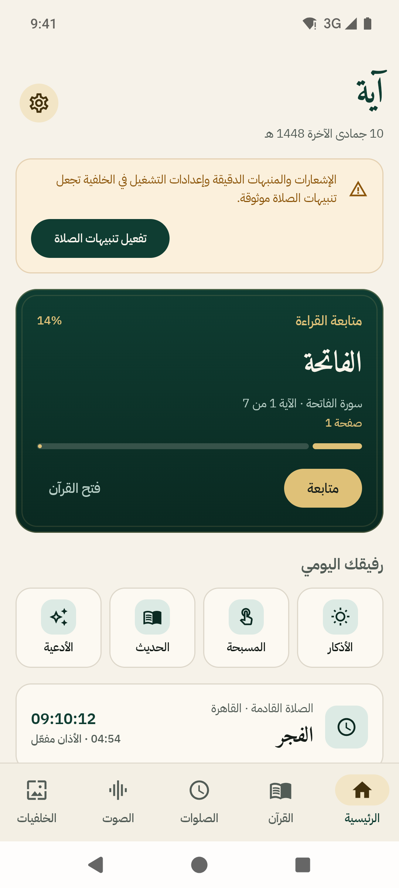 | 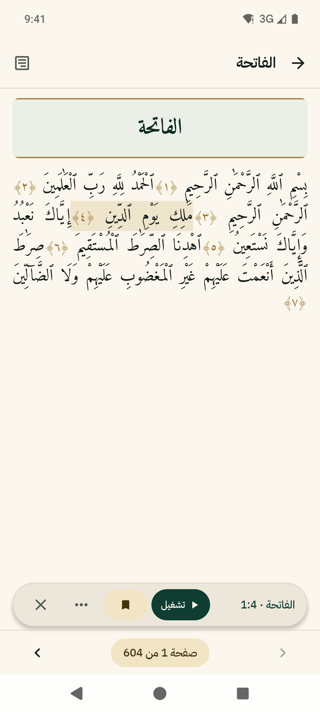 | 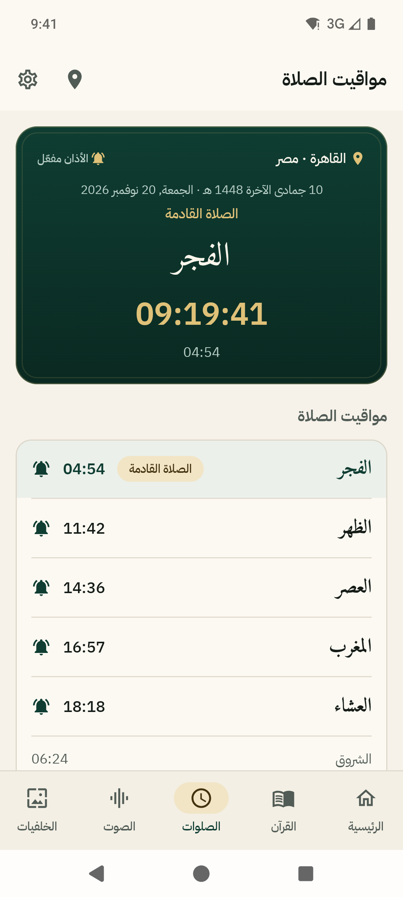 |
| **Home Dashboard (Dark)** | **604-Page Mushaf Reader (Dark)** | **Prayer Times & Adhan (Dark)** |
| 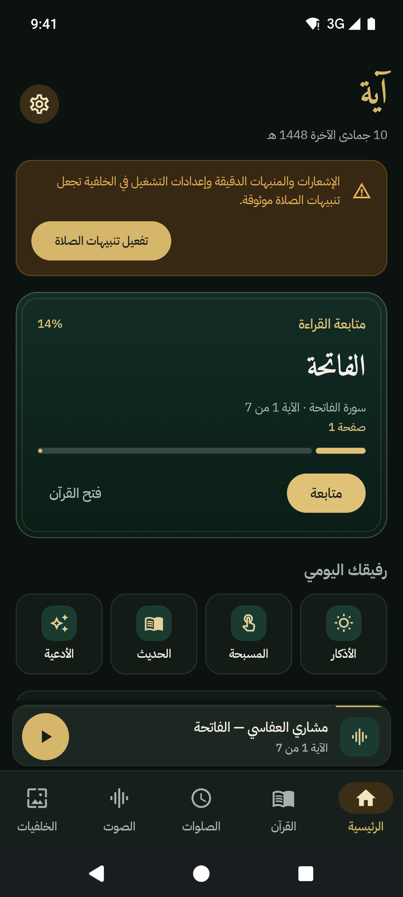 | 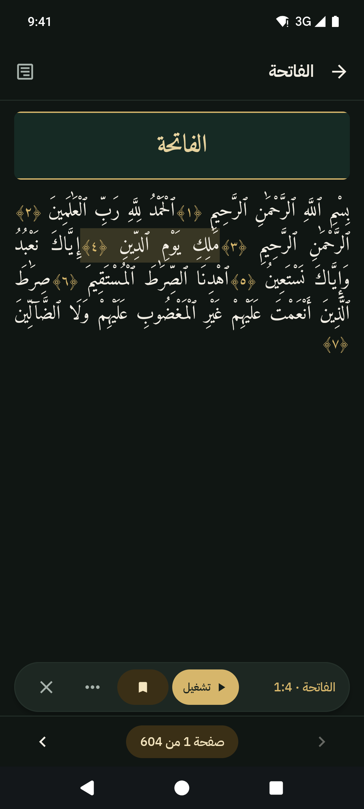 | 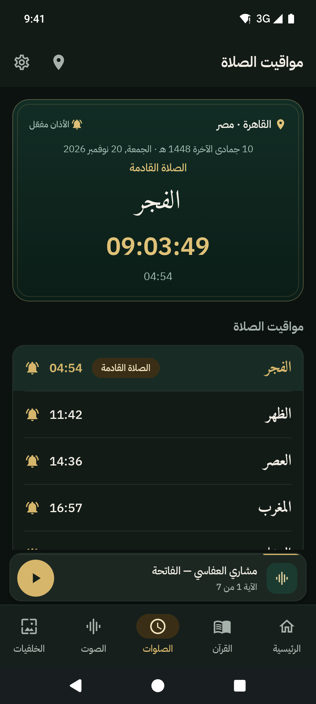 |

</div>

---

## About Ayah

Most Islamic mobile apps suffer from visual clutter, intrusive advertisements, network dependency for basic worship tasks, or fragmented utility screens. **Ayah** was built to provide a serene, cohesive, and self-contained sanctuary on Android:

- **Sacred Text Fidelity**: Ships with the complete verified **Tanzil Uthmani Quran (`v1.1`)** across all `114` Surahs, `6,236` Ayahs, `604` Madani Mushaf pages, and `30` Juz boundaries bundled locally and verified by SHA-256 checksums.
- **True Offline-First Architecture**: Quran reading, diacritic-insensitive Arabic search, bookmarking, reading progress, astronomical prayer time calculations, offline city lookup (`1,000+` global cities), `6` bundled Adhan recordings, daily Adhkar, Tasbih, Quranic/Prophetic Duas, Hadith FTS4 search (`202` authenticated entries), and `1080x2400` wallpaper generation all operate **100% offline** immediately after installation.
- **Reliable Prayer & Adhan Engine**: Local astronomical calculation via `adhan-java` paired with an Android exact-alarm pipeline, a dedicated foreground `AdhanPlaybackService`, per-prayer voice assignment, and a 5-step Android alarm/battery reliability onboarding checklist.
- **Ayah-Level Audio Playback & Offline Caching**: Powered by AndroidX Media3 (`ExoPlayer`) and `MediaSessionService`, supporting background recitation playback, per-Ayah and Ayah-range repeat loops, sleep timers, variable recitation speed, and concurrency-hardened per-Surah offline MP3 downloads.
- **Arabic-First RTL Craftsmanship**: Native Right-to-Left layout with bundled **Amiri** (Quranic calligraphy) and **IBM Plex Sans Arabic** (UI typography) fonts, custom Islamic octagram Rub el Hizb geometric badges, and full parity between Light and Dark palettes.
- **Privacy by Design**: Zero analytics SDKs, zero advertising libraries, zero user accounts, and zero telemetry. All user data remains locally on the device.

---

## Screenshots Gallery

All 50 screenshots below (`25` Light Mode and `25` Dark Mode pairs) were captured directly from the signed `v1.0.0-beta.12` release build at `1080x2400` resolution. See [docs/SCREENSHOT-INVENTORY.md](docs/SCREENSHOT-INVENTORY.md) for the complete screen-by-screen inventory and seeded state reference.

### 1. Home & Daily Reflection

| Screen | Light Mode | Dark Mode |
| :--- | :---: | :---: |
| **Home Dashboard**<br/><br/>Displays Hijri date header, prayer alarm readiness prompt, **Continue Reading** progress card (`الفاتحة` Page 1), **Daily Islamic Companion** quick-access grid (`الأذكار`, `المسبحة`, `الحديث`, `الأدعية`), and persistent `MiniPlayerBar`. |  |  |
| **Daily Reflection & Quick Actions**<br/><br/>Scrolled view of the Home screen featuring **Daily Reflection** (`تأمل اليوم` with toggleable **Ayah of the Day** and **Hadith of the Day**, direct Mushaf jump, and one-tap Wallpaper Studio transfer), **Current Wallpaper** status card, and Bookmarks/Recitations shortcuts. | 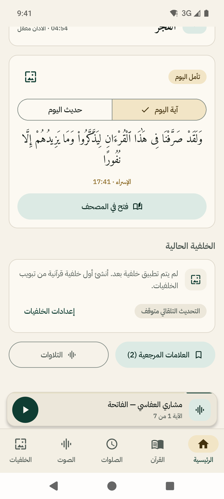 | 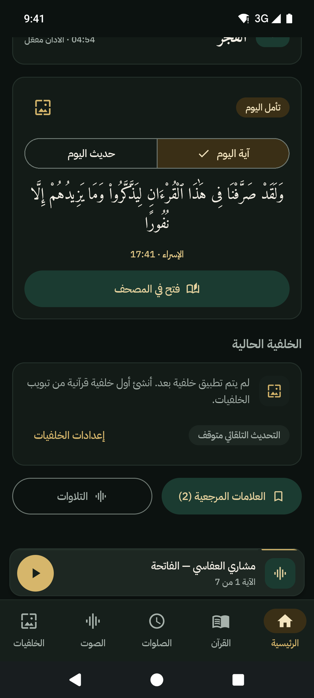 |

### 2. Holy Quran & 604-Page Mushaf Reader

| Screen | Light Mode | Dark Mode |
| :--- | :---: | :---: |
| **Quran Index — Surahs Tab (`السور`)**<br/><br/>Browse all `114` Surahs with instant Arabic search, **Jump to Page** dialog (`الانتقال إلى صفحة`), Islamic octagram Surah number badges, Makki/Madani classification, Ayah counts, and starting Madani Mushaf page numbers. | 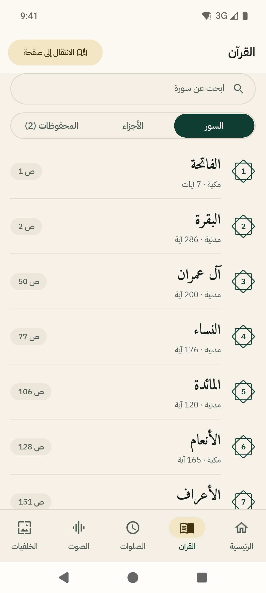 | 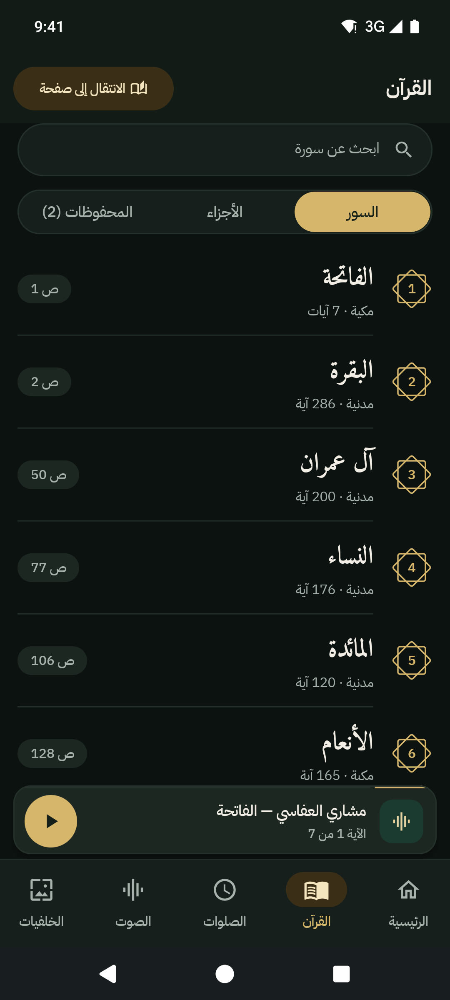 |
| **Quran Index — Juz Tab (`الأجزاء`)**<br/><br/>Navigate all `30` Juz of the Holy Quran with exact Madani page ranges (`ص 1–21`, `ص 22–41`, etc.), starting Surah:Ayah reference, and vocalized Uthmani opening verse preview. | 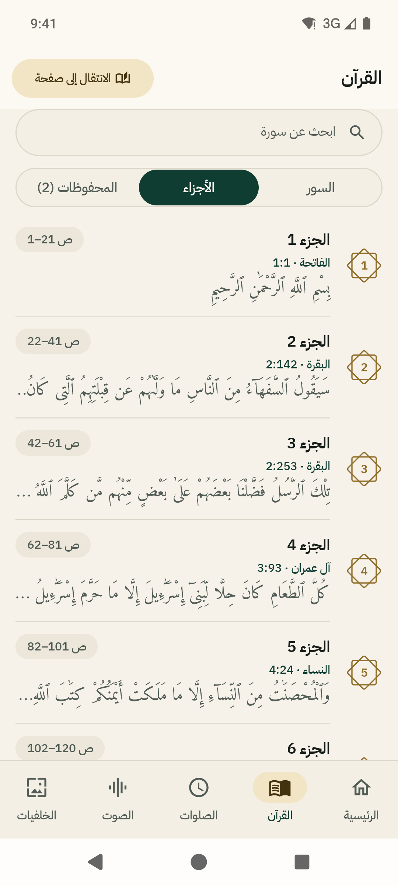 | 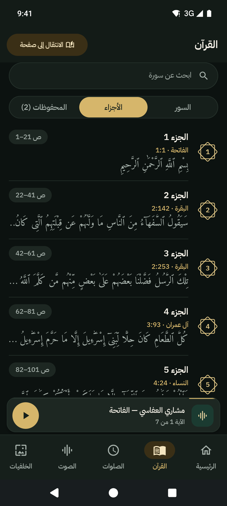 |
| **Quran Index — Bookmarks Tab (`المحفوظات`)**<br/><br/>Access saved Ayah bookmarks (`البقرة 2:2`, `الفاتحة 1:4`) with full Uthmani text, one-tap bookmark management, and direct navigation back to the exact verse in the Mushaf Reader. | 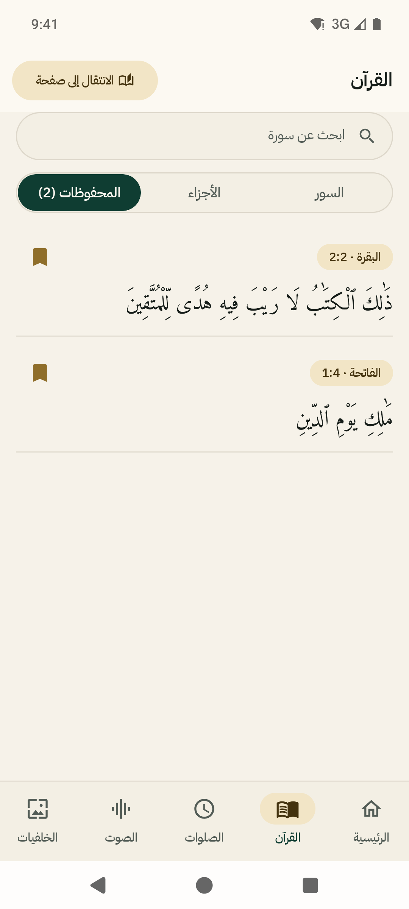 | 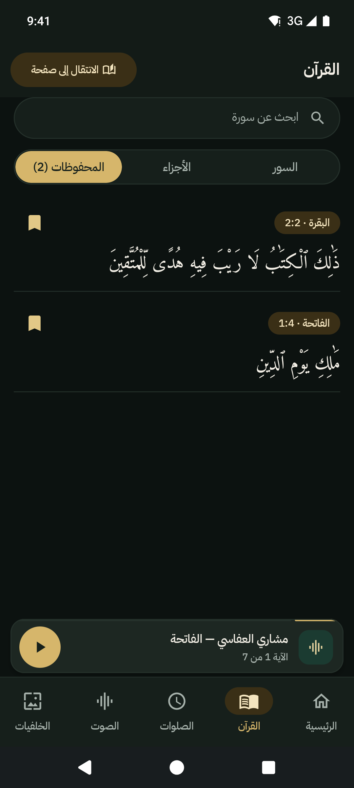 |
| **604-Page Madani Mushaf Reader**<br/><br/>Horizontal RTL pager rendering the standard `604`-page Madani Mushaf layout (`صفحة 1 من 604`) with ornamental Surah headers, justified Uthmani script, inline tap-to-select Ayah highlighting (`الفاتحة 1:4`), and floating Ayah action pill (`تشغيل`, Bookmark, Copy/Share/Wallpaper menu). |  |  |
| **Continuous Surah Reader**<br/><br/>Seamless toggle from Mushaf page mode to continuous vertical Surah flow (`وضع القراءة المستمرة`) featuring Surah metadata banner, quick font-size cycling (`TT`), repeat controls, and synchronized audio verse highlighting. | 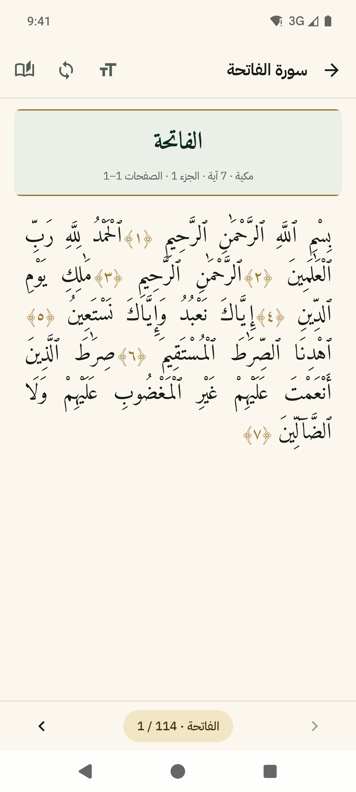 | 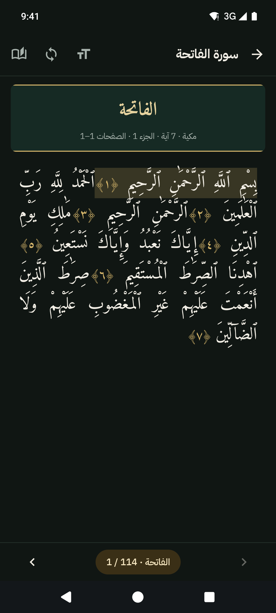 |

### 3. Prayer Times, Adhan Voices & Reliability Onboarding

| Screen | Light Mode | Dark Mode |
| :--- | :---: | :---: |
| **Prayer Times Dashboard**<br/><br/>Configured for Cairo (`القاهرة · مصر`), displaying combined Hijri & Gregorian dates, a live countdown to the upcoming prayer (`الفجر`), and all 5 daily obligatory prayer times with individual Adhan notification toggles. |  |  |
| **Prayer & Calculation Settings**<br/><br/>Configure GPS or offline city location (`القاهرة · مصر`), astronomical calculation method (`الهيئة المصرية العامة للمساحة`), Asr juristic method (Standard vs. Hanafi), high-latitude rule, per-prayer minute offsets, Hijri date adjustment (`-2` to `+2` days), and Adhan audio behavior. | 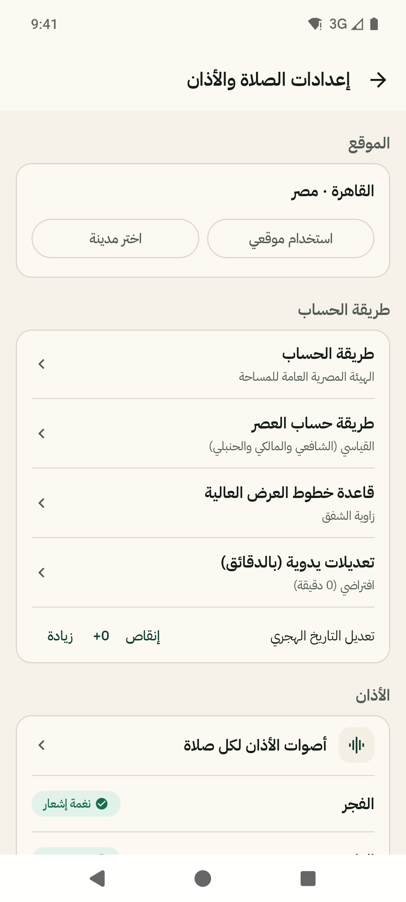 | 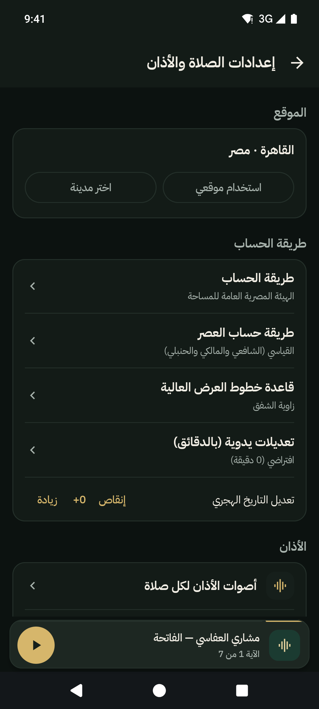 |
| **Per-Prayer Adhan Voice Assignment**<br/><br/>Apply a single Adhan recording across all five daily prayers (`تطبيق صوت واحد لجميع الصلوات`) or customize distinct Muezzin voices and inline audio previews for Fajr, Dhuhr, Asr, Maghrib, and Isha. | 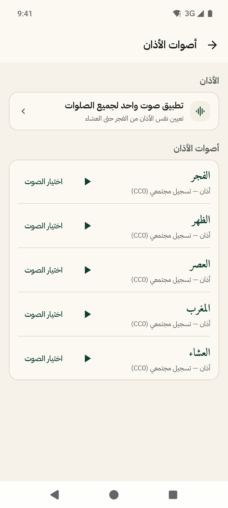 | 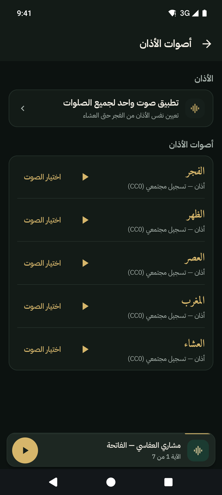 |
| **Bundled Adhan Audio Library**<br/><br/>Explore `6` bundled offline Adhan recordings (`CC0`, Public Domain, `CC BY-SA 4.0`, `CC BY 3.0`) with instant search, category filter chips (`الكل`, `مكة المكرمة`, `المدينة المنورة`, `مؤذنون مشهورون`), duration & license badges, and live preview playback. | 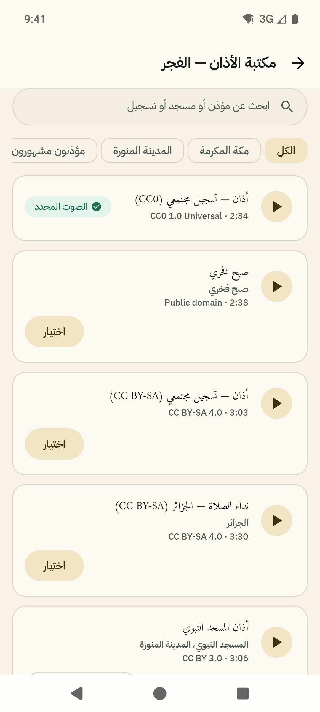 | 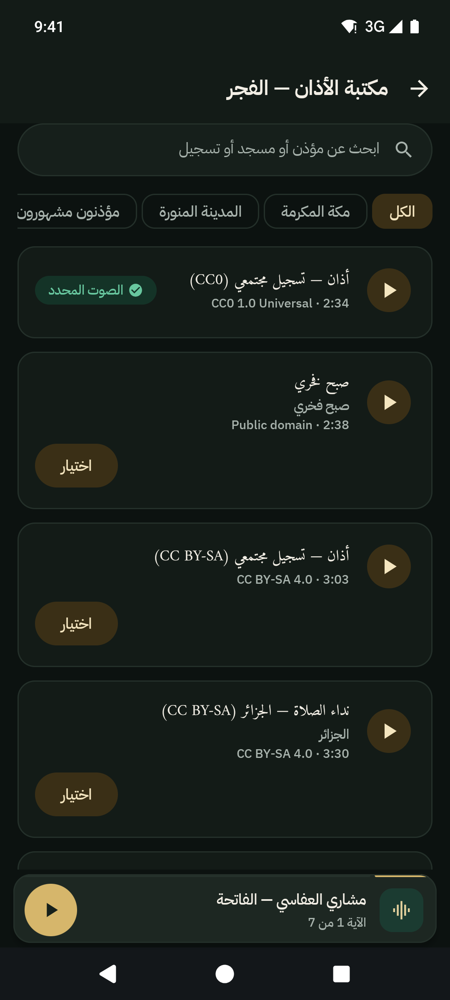 |
| **Prayer & Adhan Reliability Onboarding**<br/><br/>Guided 5-step readiness checklist (`3 / 5` progress bar) verifying Android `POST_NOTIFICATIONS` permission, Adhan notification channel status, `SCHEDULE_EXACT_ALARM` permission, OEM background battery settings, and saved location. | 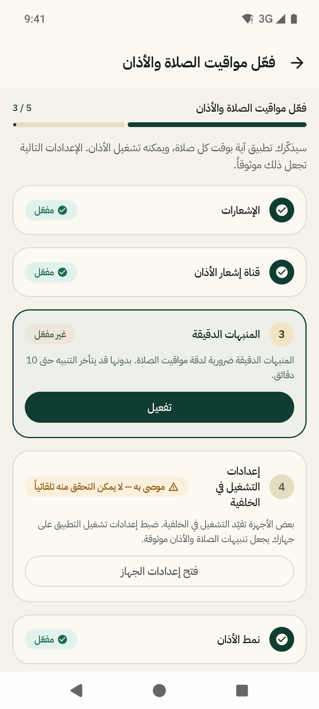 | 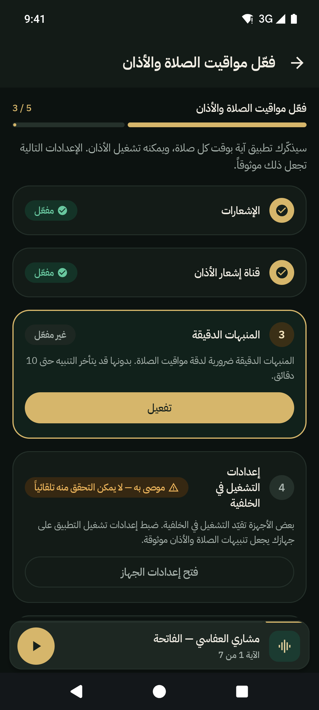 |

### 4. Audio Recitations & Media3 Player

| Screen | Light Mode | Dark Mode |
| :--- | :---: | :---: |
| **Audio Recitations & Offline Downloads**<br/><br/>Select from `4` renowned reciters (`مشاري العفاسي`, `محمود خليل الحصري`, `عبد الباسط عبد الصمد`, `عبد الرحمن السديس` at `128 kbps`), filter between All Surahs (`الكل 114`) and Downloaded Surahs (`المحملة`), stream immediately, or download Surahs for offline playback. | 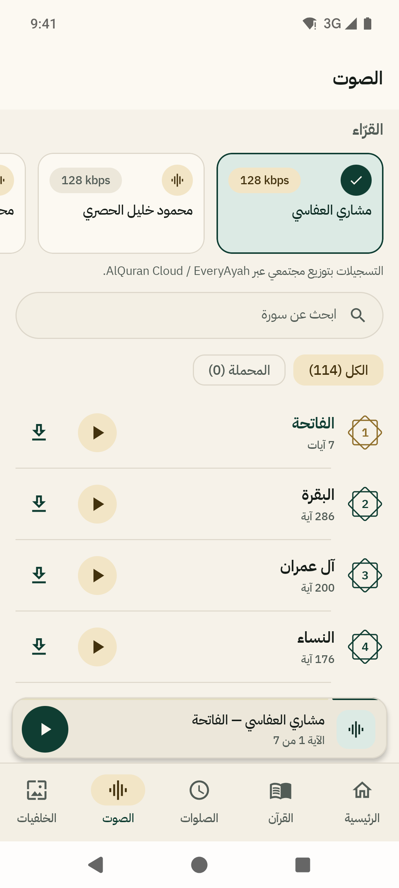 | 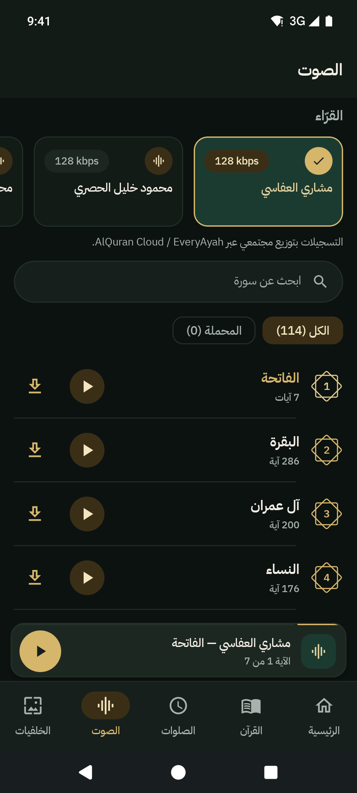 |
| **Full-Screen Now Playing Sheet**<br/><br/>Dedicated playback control center showing current Surah & reciter (`الفاتحة — مشاري العفاسي`), active Ayah indicator (`الآية 1 من 7`), seek bar, transport controls, **Open in Mushaf** shortcut, Ayah/Range repeat modes (`تكرار الآية`, `تكرار نطاق آيات`), sleep timer chips, and playback speed selector. | 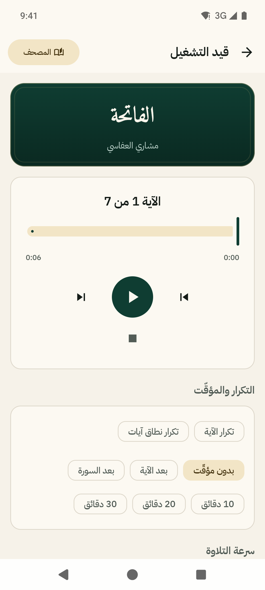 | 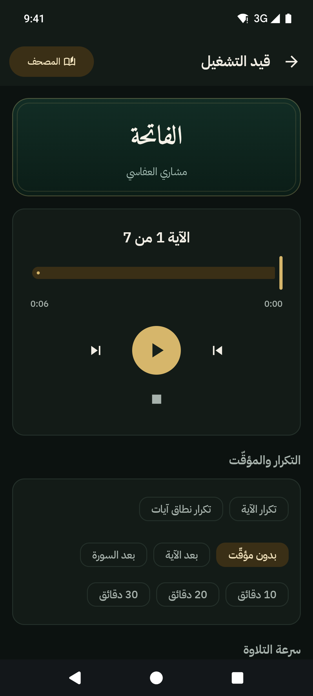 |

### 5. Quranic Wallpaper Studio

| Screen | Light Mode | Dark Mode |
| :--- | :---: | :---: |
| **Wallpaper Studio — Live Preview & Templates**<br/><br/>Real-time rendered wallpaper preview (`الإسراء 17:41`), one-tap **Random Ayah** selector (`آية عشوائية`), **Fullscreen Preview** trigger, `6` curated visual templates (`الفخامة الزمردية`, `كريمي بسيط`, `ذهب منتصف الليل`, `العمارة الإسلامية`, `نسيم الفجر`, `الليلة المباركة`), and target screen selector (`الرئيسية`, `القفل`, `كلاهما`). | 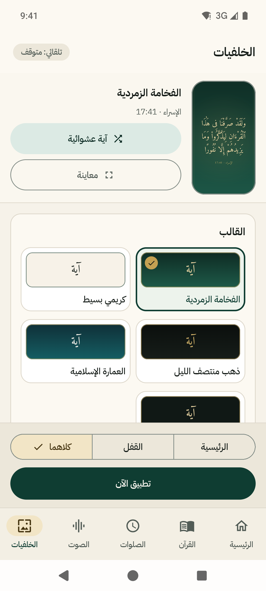 | 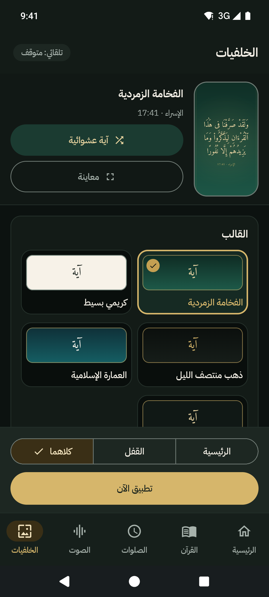 |
| **Wallpaper Studio — Typography & Ayah Picker**<br/><br/>Fine-tune Arabic verse presentation with a stepped font-size slider (`70%` to `140%`), vertical text alignment (`أعلى`, `وسط`, `أسفل`), and manual Surah & Ayah picker to turn any of the `6,236` Quranic verses into a `1080x2400` wallpaper. | 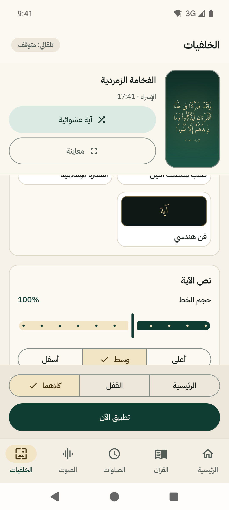 | 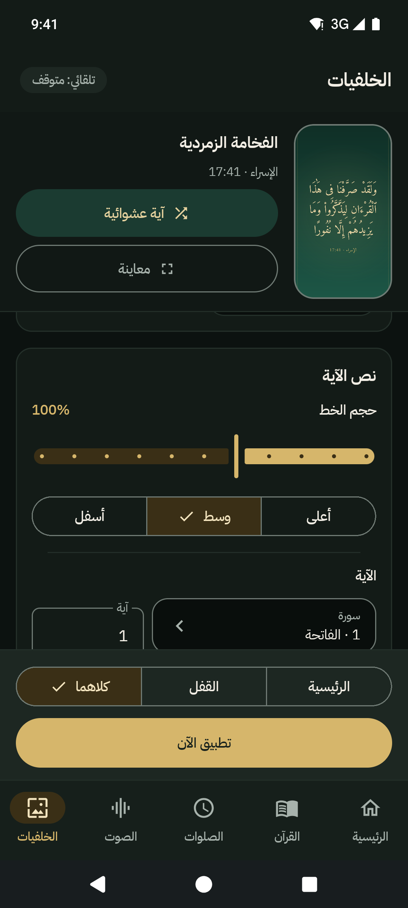 |
| **Wallpaper Full-Screen Preview**<br/><br/>Edge-to-edge `1080x2400` full-screen inspection modal displaying the rendered Uthmani calligraphy, ornamental borders, and Surah:Ayah citation with direct Home/Lock/Both target selection and one-tap system application (`تطبيق الخلفية`). | 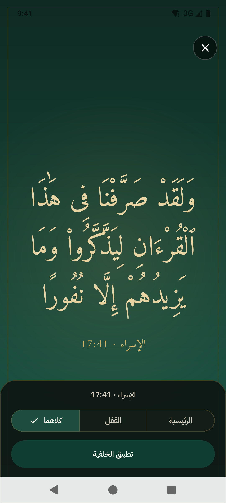 | 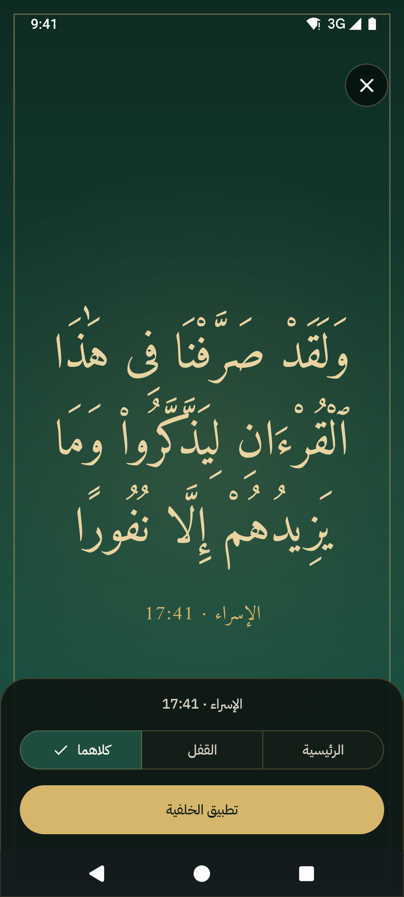 |

### 6. Daily Islamic Companion — Adhkar, Tasbih, Duas & Hadith

| Screen | Light Mode | Dark Mode |
| :--- | :---: | :---: |
| **Adhkar Hub (`الأذكار`)**<br/><br/>Time-aware recommended session card (`أذكار الصباح` / `أذكار المساء`), instant Adhkar search, daily completion progress cards across Morning (`26`), Evening (`24`), After-Prayer (`8`), Sleep (`15`), and Waking (`4`) Adhkar, plus daily Sunnah Surah shortcuts. | 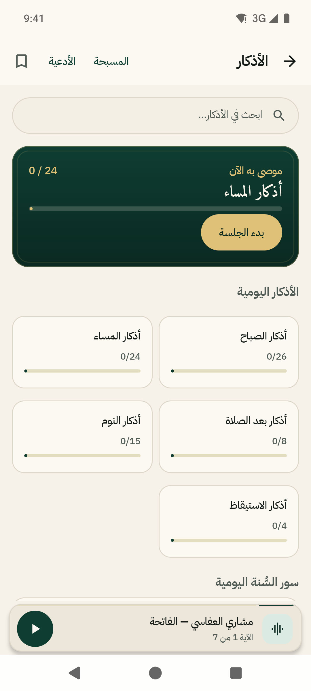 | 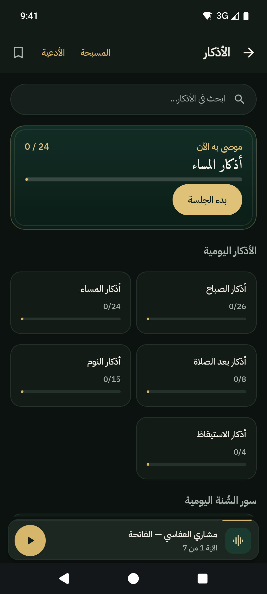 |
| **Interactive Adhkar Session**<br/><br/>Focused card-by-card session (`أذكار الصباح 1 / 26`) with font scaling (`A+` / `A-`), vocalized Dhikr text, authentic Hadith narration & grading, collapsible virtue note (`الفضل والمناسبة`), copy/favorite buttons, and tactile progress tap button (`تمت القراءة`) with undo support. | 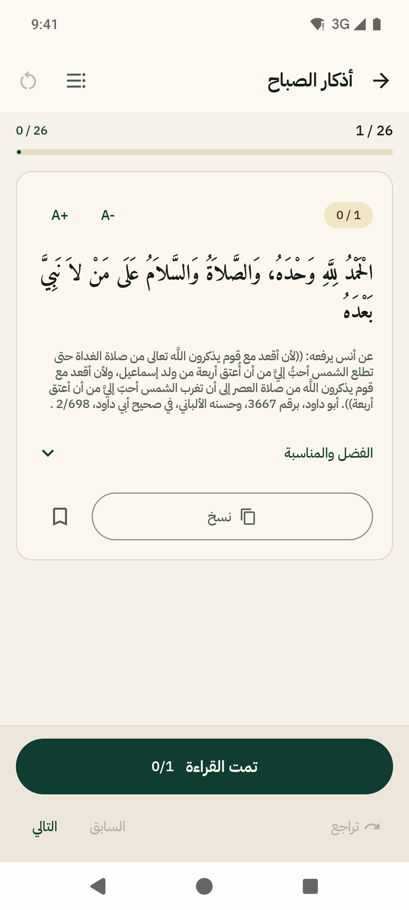 | 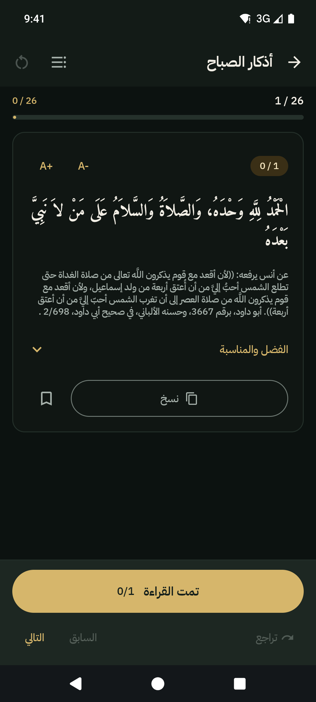 |
| **Digital Tasbih Counter (`المسبحة`)**<br/><br/>Interactive circular progress ring (`7 / 33` for `سُبْحَانَ اللَّهِ`), preset & custom Dhikr phrases, target count chips (`بدون هدف`, `33`, `100`, `1000`, `مخصص`), remaining & daily total counters (`متبقي 26`, `اليوم: 7`), haptic feedback toggle, and undo/next/reset controls. | 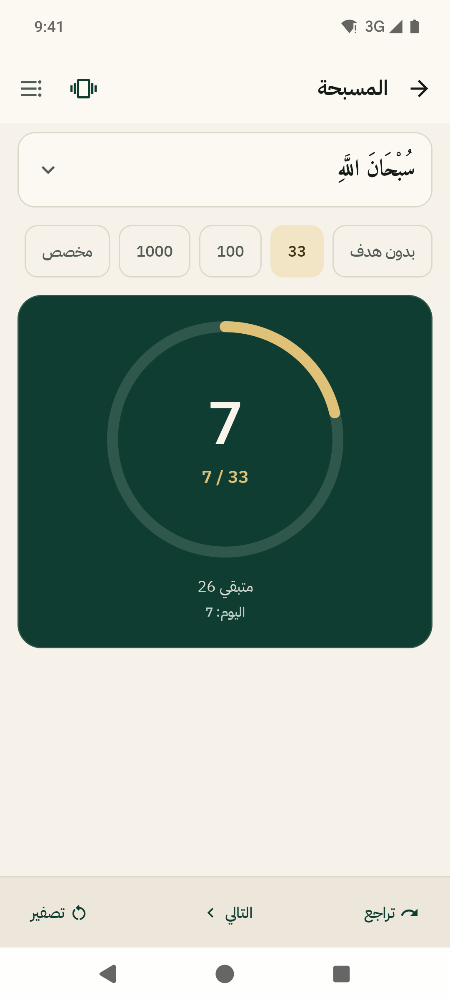 | 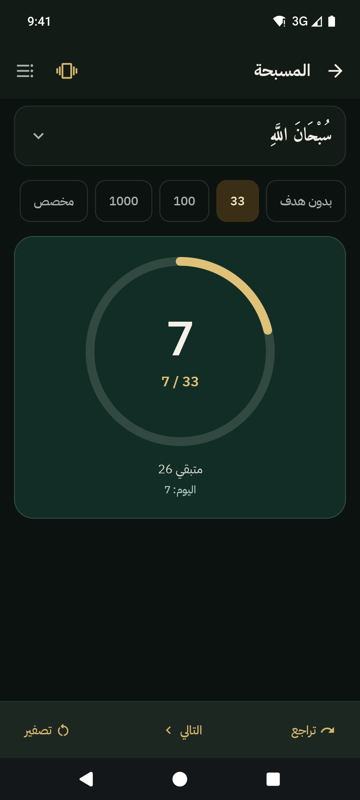 |
| **Quranic & Prophetic Duas (`الأدعية`)**<br/><br/>Categorized supplications filterable by source (`قرآنية`, `نبوية`, `حسب الحال`) and spiritual topic (`الهداية والثبات`, `المغفرة والتوبة`, `الأهل والذرية`, etc.), with vocalized Arabic text, one-tap copy, and direct **Open in Mushaf** (`فتح في المصحف`) navigation. | 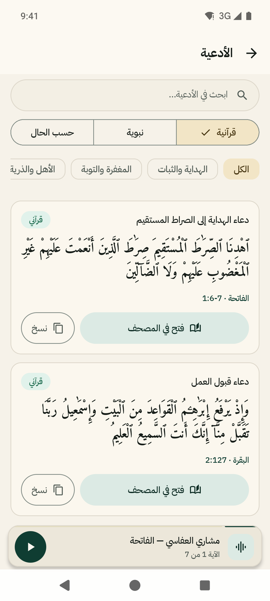 | 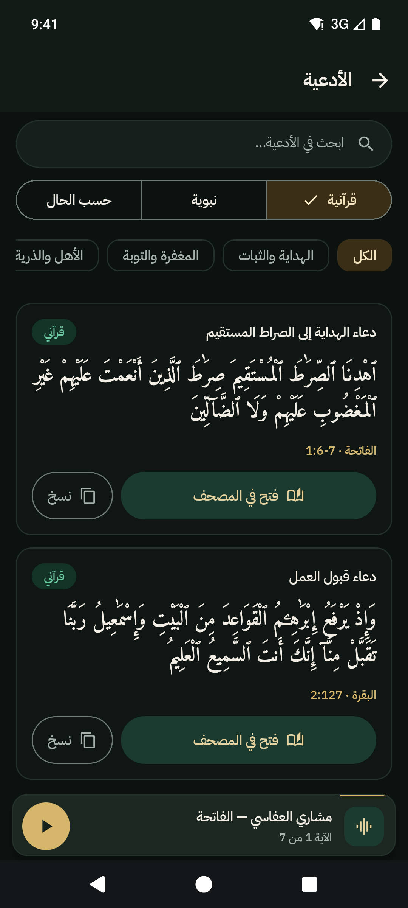 |
| **Hadith Library & Offline FTS4 Search (`مكتبة الحديث`)**<br/><br/>`202` authenticated Hadiths across An-Nawawi's Forty Hadith (`الأربعون النووية`) and thematic chapters (`القرآن الكريم وعلومه`, `العقيدة`, etc.), backed by an offline SQLite **FTS4** full-text index supporting instant Arabic and English search. | 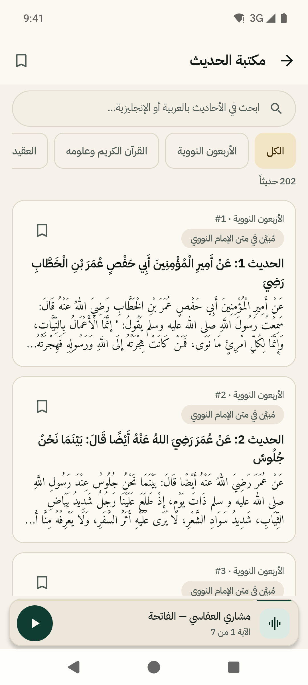 | 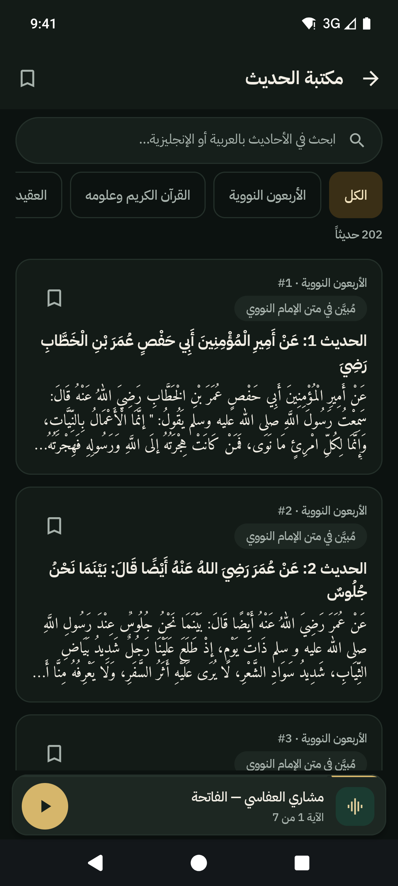 |
| **Hadith Reader Detail**<br/><br/>Full vocalized Hadith presentation (`الحديث 1 — إنما الأعمال بالنيات`) with narrator chain, authenticity badge (`مُبيَّن في متن الإمام النووي`), adjustable text scaling (`A+` / `A-`), bookmarking, clipboard copy, and structured source attribution (`المصدر والتخريج`). | 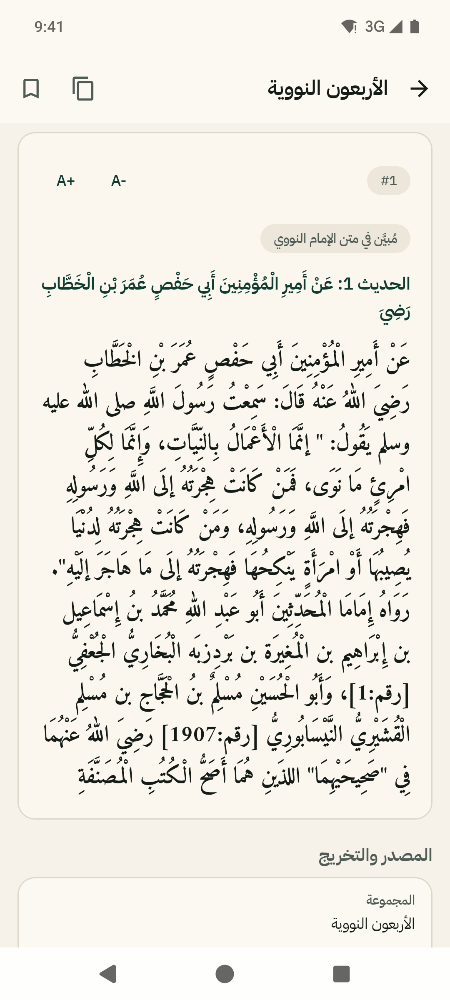 | 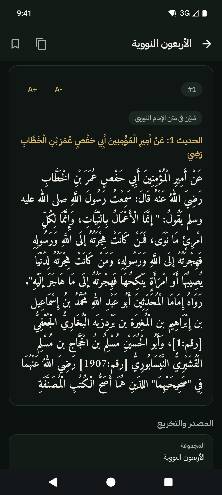 |

### 7. Settings, Daily Reminders & In-App Updater

| Screen | Light Mode | Dark Mode |
| :--- | :---: | :---: |
| **Settings — Theme, Reading & Audio**<br/><br/>Visual theme cards (`تلقائي`, `فاتح`, `داكن`), live reading font-size slider (`70%` to `150%`) with real-time Bismillah preview, default Quran reciter selector, and quick access to Prayer & Adhan configuration. | 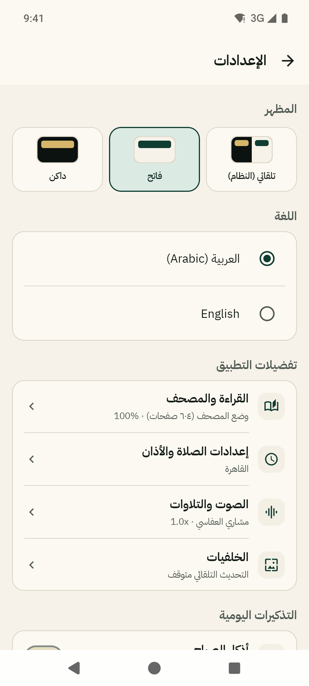 | 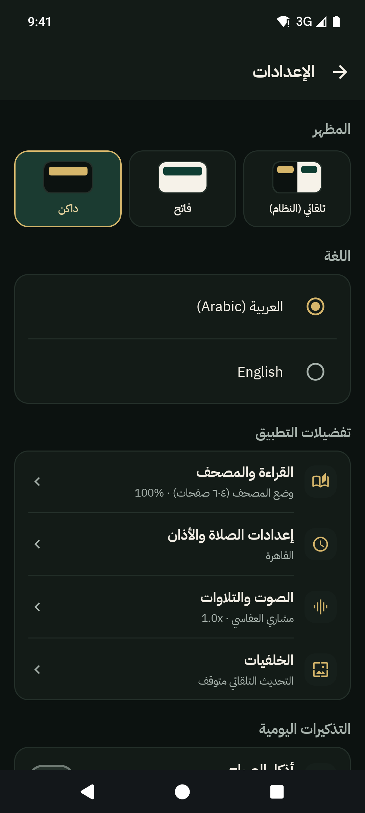 |
| **Settings — Daily Reminders, Updates & About**<br/><br/>Configurable daily reminders with custom time pickers (Morning Adhkar `07:00`, Evening Adhkar `17:30`, Sleep Adhkar `22:00`, Friday Surah Al-Kahf `10:00`), automatic daily wallpaper schedule, security-hardened **GitHub Release Updater** (`1.0.0-beta.12`), and open-data attribution footer. | 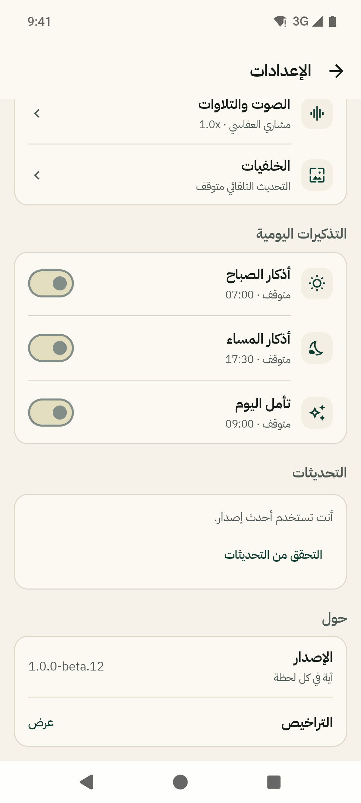 | 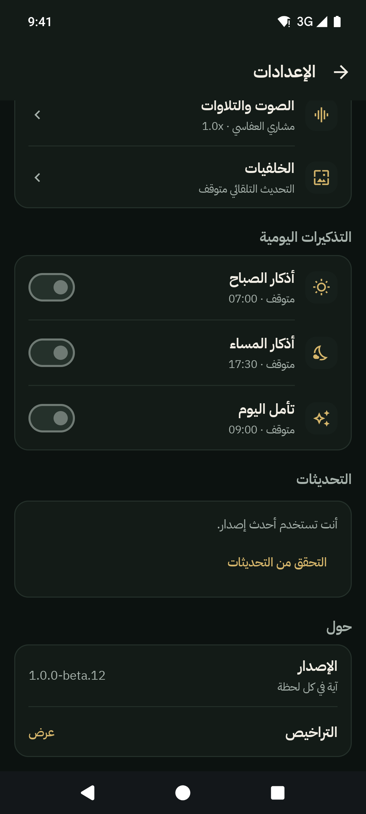 |

---

## Features

### 1. Holy Quran & Reading Experience
- **604-Page Madani Mushaf Reader**: True horizontal RTL page-by-page Mushaf layout (`صفحة 1 من 604`) mapped to standard Madani page boundaries (`ayah-metrics.txt` & `quran-data.xml`), with ornamental Surah headers, automatic Bismillah rendering (excluding Surah At-Tawbah), and inline tap-to-select Ayah highlighting.
- **Continuous Surah Reader**: Toggle instantaneously between paginated Mushaf mode and continuous vertical Surah scrolling (`وضع القراءة المستمرة`).
- **114-Surah, 30-Juz & 240-Rub' Navigation**: Browse by Surah (`السور`), Juz (`الأجزاء`), Rub' al-Hizb (`الأرباع`), or Saved Bookmarks (`المحفوظات`), or jump directly to any Madani Mushaf page (`1–604`).
- **Diacritic-Insensitive Arabic Search**: Normalizes Arabic Tashkeel, Alef variants (`أ إ آ ٱ -> ا`), and Ta-Marbuta so users can search Surahs and verses effortlessly without typing diacritics.
- **Bookmarks & Reading Streak Tracking**: Bookmark any Ayah with a single tap, resume exactly where you left off from the Home card, and track weekly reading consistency.

### 2. Prayer Times & Adhan Notifications
- **Offline Astronomical Calculation**: Computes Fajr, Sunrise, Dhuhr, Asr, Maghrib, and Isha locally using `adhan-java` with support for major global calculation methods (Egyptian General Authority, Umm al-Qura, Muslim World League, ISNA, Karachi, Dubai, Qatar, Kuwait, Moonsighting Committee), Standard & Hanafi Asr juristic rules, high-latitude rules, and manual per-prayer minute offsets.
- **GPS & Offline City Search**: Automatically detect coordinates via device location or search offline across `1,000+` bundled world cities (`cities.json` from GeoNames) in Arabic or English.
- **Bundled Multi-Voice Adhan Library**: Includes `6` offline Adhan recordings in `res/raw/` assignable globally or individually per prayer, with live audio preview and license attribution.
- **Exact-Alarm & Foreground Adhan Pipeline**: Schedules exact wake alarms via `AlarmManager`, plays Adhan through a dedicated foreground `AdhanPlaybackService` respecting device ringer/DND rules, and automatically reschedules across device reboots, timezone shifts, and app upgrades.

### 3. Audio Recitations & Media3 Playback
- **4 Renowned Reciters**: Stream or download complete Surah recitations (`128 kbps`) by Mishary Rashid Alafasy, Mahmoud Khalil Al-Husary, AbdulBaset AbdulSamad (Murattal), and Abdurrahmaan As-Sudais.
- **Ayah-Synchronized Media3 Engine**: Built on AndroidX Media3 `ExoPlayer` and `MediaSessionService` for background playback, system media notification controls, persistent `MiniPlayerBar`, and full-screen `NowPlayingScreen`.
- **Memorization & Listening Tools**: Single-Ayah repeat (`تكرار الآية`), custom Ayah-range repeat loops (`تكرار نطاق آيات`), playback speed adjustment (`0.75x`, `1.0x`, `1.25x`, `1.5x`), and automatic sleep timers (`بعد الآية`, `بعد السورة`, `10`, `20`, or `30` minutes).
- **Concurrency-Hardened Offline Downloads**: Download entire Surahs for offline playback with per-Ayah progress tracking, resumable partial downloads, and per-Surah mutex/generation synchronization.

### 4. Daily Islamic Companion
- **Adhkar Hub & Guided Sessions (`الأذكار`)**: Categorized Morning, Evening, After-Prayer, Sleep, and Waking Adhkar with time-of-day recommendations, interactive tap counters, undo history, collapsible virtues (`الفضل والمناسبة`), and daily completion streaks.
- **Digital Tasbih (`المسبحة`)**: Animated circular progress ring, customizable Dhikr phrases, selectable targets (`33`, `100`, `1000`, custom, or open-ended), optional haptic feedback, and daily tally persistence.
- **Quranic & Prophetic Duas (`الأدعية`)**: Curated supplications organized by source and life situation, featuring one-tap clipboard copy and direct deep-linking to the source verse inside the Mushaf Reader.
- **Offline Hadith Library (`مكتبة الحديث`)**: `202` vocalized Hadiths (including An-Nawawi's Forty Hadith) indexed with SQLite **FTS4** for instant offline Arabic and English full-text search.

### 5. Quranic Wallpaper Studio
- **High-Resolution `1080x2400` Canvas Renderer**: Generates crisp portrait wallpapers off-screen using native Android `Canvas`, `StaticLayout`, and bundled Amiri calligraphy.
- **6 Curated Visual Templates**: Emerald Luxury (`الفخامة الزمردية`), Minimal Cream (`كريمي بسيط`), Midnight Gold (`ذهب منتصف الليل`), Islamic Architecture (`العمارة الإسلامية`), Fajr Breeze (`نسيم الفجر`), and Blessed Night (`الليلة المباركة`).
- **Full Typography & Target Control**: Customize font scale (`70%–140%`), vertical alignment (`أعلى`, `وسط`, `أسفل`), and target surface (Home screen, Lock screen, or Both), or enable automatic daily wallpaper rotation via `WorkManager`.

### 6. Personalization, Reminders & Security-Hardened Updates
- **Light, Dark & System Themes**: Instant switching between Warm Ivory Light Mode, Deep Obsidian Dark Mode, and System Default.
- **Configurable Daily Reminders**: Schedule non-intrusive reminders for Morning Adhkar, Evening Adhkar, Sleep Adhkar, and Friday Surah Al-Kahf reading.
- **Verified In-App GitHub Release Updater**: Checks GitHub Releases for newer builds and validates HTTPS redirect allowlists, SHA-256 APK checksums, and X.509 signing certificate fingerprints before installation.

---

## Technology Stack

All versions below are verified directly from [gradle/libs.versions.toml](gradle/libs.versions.toml) and [app/build.gradle.kts](app/build.gradle.kts):

| Category | Technology / Library | Version | Purpose |
| :--- | :--- | :--- | :--- |
| **Language & Runtime** | Kotlin / Coroutines | `2.2.10` / `1.10.2` | Primary language, structured concurrency, reactive `Flow` & `StateFlow` |
| **Build System** | Android Gradle Plugin / KSP | `8.13.2` / `2.2.10-2.0.2` | Build toolchain and annotation processing (`compileSdk = 35`, `minSdk = 26`) |
| **UI Framework** | Jetpack Compose BOM & Material 3 | `2026.03.00` | Declarative RTL UI, custom design tokens, animations, horizontal Mushaf pager |
| **Architecture & Navigation** | Lifecycle ViewModel & Navigation Compose | `2.10.0` / `2.9.7` | Unidirectional data flow state holders and type-safe Compose navigation graph |
| **Dependency Injection** | Dagger Hilt & Hilt Work | `2.57.2` / `1.3.0` | Compile-time DI across Application, ViewModels, Services, and ListenableWorkers |
| **Local Database** | AndroidX Room (SQLite + FTS4) | `2.8.4` | Schema `v4` (`17` entities, explicit migrations `v1..v4`, FTS4 Hadith full-text index) |
| **Preferences Storage** | Jetpack DataStore (Preferences) | `1.2.0` | Reactive key-value persistence for theme, typography, prayer, and reminder settings |
| **Audio Engine** | AndroidX Media3 (ExoPlayer & Session) | `1.9.2` | Gapless Ayah playlist playback, background `MediaSessionService`, notification controls |
| **Background Scheduling** | AndroidX WorkManager & AlarmManager | `2.11.1` | Exact prayer alarms, daily Adhkar/Friday reminders, and auto-wallpaper rotation |
| **Prayer Calculation** | `com.batoulapps.adhan:adhan` | `1.2.1` | Offline astronomical calculation of Islamic prayer times and Hijri adjustments |
| **Networking** | OkHttp | `4.12.0` | Shared HTTP client for Surah audio downloads and hardened GitHub Release update checks |
| **Testing** | JUnit 4, MockK, Turbine, Coroutines Test, Room Testing, Compose UI Test | `4.13.2` / `1.14.9` / `1.2.1` | `264` JVM unit tests + `85` instrumented Android device/emulator tests |

---

## Architecture Overview

Ayah is structured around **Clean Architecture** with strict unidirectional data flow from repositories to Compose UI screens. For an in-depth technical breakdown of package boundaries, Room Schema `v4` tables, and concurrency design, see [docs/ARCHITECTURE.md](docs/ARCHITECTURE.md).


---

## Offline-First Philosophy

Ayah is designed so that your daily worship and reading never depend on an internet connection:

| Capability | Works 100% Offline | Optional Network Usage |
| :--- | :---: | :--- |
| **Holy Quran Reading (`114` Surahs, `6,236` Ayahs, `604` Mushaf Pages, `30` Juz)** | Yes (Bundled & Room-seeded) | None |
| **Arabic Quran Search, Bookmarks & Reading Progress** | Yes | None |
| **Prayer Time Calculation & `1,000+` Global Cities Search** | Yes (`adhan-java` + bundled GeoNames) | None |
| **Adhan Notifications & `6` Bundled Muezzin Voices** | Yes (Bundled in `res/raw/`) | None |
| **Daily Adhkar, Digital Tasbih & Quranic/Prophetic Duas** | Yes (Bundled & Room-seeded) | None |
| **Hadith Library (`202` Hadiths) & Bilingual FTS4 Search** | Yes (SQLite FTS4 index) | None |
| **Quranic Wallpaper Studio (`1080x2400` Canvas Renderer)** | Yes (Bundled Amiri/IBM Plex fonts) | None |
| **Quran Audio Recitations (`4` Reciters)** | Yes (Once Surahs are downloaded) | Streams or downloads MP3s from AlQuran Cloud / EveryAyah CDN |
| **In-App Release Updates** | N/A | Checks GitHub Releases API when requested or scheduled |

---

## Project Structure

```text
Ayah-Quran/
├── app/
│   ├── schemas/com.ayah.quran.core.database.AyahDatabase/
│   │   ├── 1.json .. 4.json               # Exported Room database schemas (v1 through v4)
│   ├── src/
│   │   ├── main/
│   │   │   ├── assets/
│   │   │   │   ├── companion/             # Bundled JSON seeds: Adhkar, Duas, Tasbih presets, Hadith library
│   │   │   │   ├── prayer/cities.json     # Bundled GeoNames offline world cities catalog (1,000+ cities)
│   │   │   │   └── quran/                 # quran-uthmani.txt (Tanzil Uthmani v1.1), quran-data.xml, ayah-metrics.txt, rub-el-hizb.txt
│   │   │   ├── java/com/ayah/quran/
│   │   │   │   ├── core/                  # Room v4 database, migrations, DataStore, Material 3 design system
│   │   │   │   ├── data/                  # Repositories, seeders, Media3 player, downloader, updater
│   │   │   │   ├── di/                    # Hilt modules (Database, Network, CoroutineScopes, Companion)
│   │   │   │   ├── domain/                # Pure Kotlin domain models and repository interfaces
│   │   │   │   ├── feature/               # Prayer calculation/alarm pipeline & Wallpaper bitmap renderer
│   │   │   │   ├── notification/          # Notification channels and daily reminder schedulers
│   │   │   │   ├── ui/                    # 21 Jetpack Compose screens, navigation graph, RTL locale helper
│   │   │   │   └── work/                  # WorkManager background workers (Wallpaper, Reminders, Prayer)
│   │   │   └── res/
│   │   │       ├── font/                  # Bundled Amiri & IBM Plex Sans Arabic TTF fonts
│   │   │       ├── raw/                   # 6 bundled offline Adhan OGG recordings
│   │   │       └── values/                # Arabic-first string resources and themes
│   │   ├── test/                          # 49 JVM unit test suites (264 unit tests)
│   │   └── androidTest/                   # 16 instrumented Android test suites (85 device/emulator tests)
│   └── build.gradle.kts                   # App module configuration (versionName = "1.0.0-beta.12", versionCode = 13)
├── docs/
│   ├── assets/screenshots/                # 50 real app screenshots (25 Light + 25 Dark pairs across 10 folders)
│   ├── ADHAN-AUDIO-LICENSES.md            # License and attribution details for bundled Adhan audio
│   ├── ADHAN-AUDIO-SOURCES.md             # Source URLs and normalization metrics for Adhan recordings
│   ├── ARCHITECTURE.md                    # Comprehensive Clean Architecture & Room v4 technical reference
│   ├── LICENSES.md                        # Third-party library, font, dataset, and audio licenses
│   ├── QURAN_DATA.md                      # Tanzil Uthmani v1.1 data provenance and SHA-256 checksums
│   └── SCREENSHOT-INVENTORY.md            # Screen inventory and verification checklist for all 50 screenshots
├── gradle/libs.versions.toml              # Centralized Gradle version catalog
├── CONTRIBUTING.md                        # Contribution guidelines and data integrity rules
└── README.md                              # Project showcase and documentation
```

---

## Getting Started

### Prerequisites

- **JDK 17** (required by Android Gradle Plugin `8.13.2` and Kotlin `2.2.10`)
- **Android SDK 35** (`compileSdk = 35`, `targetSdk = 35`, `minSdk = 26`)
- **Android Studio** Ladybug (`2024.2.1`) or newer

### Clone & Build

1. **Clone the repository**:
   ```bash
   git clone https://github.com/xAhmedAdel/Ayah-Quran.git
   cd Ayah-Quran
   ```

2. **Build the Debug APK**:
   ```bash
   ./gradlew assembleDebug
   ```
   The compiled debug APK will be generated at:
   `app/build/outputs/apk/debug/app-debug.apk`

3. **Install on a Connected Device or Emulator**:
   ```bash
   ./gradlew installDebug
   ```

### Optional: Building a Signed Release APK

Release signing reads keystore credentials from a root `keystore.properties` file (which is git-ignored and never committed). To build a signed release locally, create `keystore.properties` in the project root:

```properties
storeFile=path/to/your-release-key.jks
storePassword=your_store_password
keyAlias=your_key_alias
keyPassword=your_key_password
```

Then assemble the release APK:

```bash
./gradlew assembleRelease
```

If `keystore.properties` is absent, `assembleRelease` remains runnable using the debug signing config for local verification.

---

## Testing & Quality

Ayah maintains an automated test suite verifying data integrity, database migrations, astronomical calculations, concurrency edge cases, and RTL UI rendering:

| Test Suite | Test Classes | Total Tests | Status | Scope Covered |
| :--- | :---: | :---: | :---: | :--- |
| **JVM Unit Tests** (`./gradlew testDebugUnitTest`) | `49` | `264` | `264 Passed, 0 Failed` | Tanzil Uthmani parser (`6,236` Ayahs), diacritic normalization, Madani `604`-page & `30`-Juz mapping, PrayerTimeCalculator, PrayerAlarmScheduler, AdhanPlaybackPolicy, QuranAudioDownloadRepository concurrency & generation safety, ExoPlayer playlist preparation & stop races, UpdateSecurityValidator (HTTPS redirect & X.509 cert pinning), Companion repositories, ViewModels |
| **Instrumented Android Tests** (`./gradlew connectedDebugAndroidTest`) | `16` | `85` | `84 Passed, 0 Failed, 1 Skipped` | Room database migrations (`v1 -> v2 -> v3 -> v4`), bundled asset SHA-256 verification, full database seeding, Hadith FTS4 queries, `1080x2400` wallpaper bitmap rendering, Compose RTL layout assertions, navigation smoke tests |

Run the unit test suite at any time with:

```bash
./gradlew testDebugUnitTest
```

---

## Quran Data & Attribution

Ayah is built upon verified open Islamic datasets, typography, and recordings. Full legal texts and checksums are documented in [docs/QURAN_DATA.md](docs/QURAN_DATA.md), [docs/LICENSES.md](docs/LICENSES.md), [docs/ADHAN-AUDIO-SOURCES.md](docs/ADHAN-AUDIO-SOURCES.md), and [docs/ADHAN-AUDIO-LICENSES.md](docs/ADHAN-AUDIO-LICENSES.md).

### 1. Quranic Text — Tanzil Project (CC-BY 3.0)
- **Source**: [Tanzil.net](https://tanzil.net) — Tanzil Quran Text, **Uthmani, Version 1.1** (February 2021, `quran-uthmani.txt`) and Tanzil Quran metadata (`quran-data.xml`)
- **Copyright**: Copyright (C) 2007–2026 Tanzil Project
- **License**: [Creative Commons Attribution 3.0 Unported (CC-BY 3.0)](https://creativecommons.org/licenses/by/3.0/)
- **Integrity Policy**: The Quranic text is bundled unmodified (`114` Surahs, `6,236` numbered Ayahs) and verified by SHA-256 checksums:

| Bundled Asset | Content | SHA-256 Checksum |
| :--- | :--- | :--- |
| `app/src/main/assets/quran/quran-uthmani.txt` | Tanzil Quran Text, Uthmani, Version 1.1 (verbatim with copyright block) | `bf4f57b968d03f4131c070b1e285da9be0e0a108a21c910e872801ca273312c8` |
| `app/src/main/assets/quran/quran-data.xml` | Tanzil Quran metadata (114 Surah names/types/counts, 30 Juz boundaries) | `59da25958547318e524793563ea6a233144ce04513862563bc604d8f683cec03` |
| `app/src/main/assets/quran/ayah-metrics.txt` | Per-Ayah Juz & Madani Mushaf page mapping (`surah\|ayah\|juz\|page`) | `8476c68b7cc7fcb44b94f29ef17be0246c695251b670c7580ce4825ab4b77804` |
| `app/src/main/assets/quran/rub-el-hizb.txt` | 240 Rub' al-Hizb (Quarter-Hizb) boundaries (`rub\|surah\|ayah`) | `840104f1947e3585f2067f5a70bd5790fdcc85575b2f50889d4d9a3eaab78cf4` |

### 2. Mushaf Pagination, Juz & Rub' al-Hizb Boundaries
- **Source**: Standard `604`-page Madani Mushaf page/Juz mapping (`ayah-metrics.txt`) and `240` Rub' al-Hizb boundaries (`rub-el-hizb.txt`) derived from [quran.com](https://quran.com) API v4 (KFGQPC Madani Mushaf layout) and cross-checked against Tanzil metadata (`v1.0`, CC-BY). See [docs/QURAN_DATA.md](docs/QURAN_DATA.md) for verification details including the Rub' 106 (`15:49` vs Tanzil `15:50`) audit note.

### 3. Arabic Typography (SIL Open Font License 1.1)
- **Amiri (`Amiri-Regular.ttf`, `Amiri-Bold.ttf`)**: Classical Naskh typeface designed by Khaled Hosny for typesetting the Holy Quran ([SIL OFL 1.1](https://scripts.sil.org/OFL)).
- **IBM Plex Sans Arabic (`IBMPlexSansArabic-Regular.ttf`, `IBMPlexSansArabic-Medium.ttf`, `IBMPlexSansArabic-SemiBold.ttf`, `IBMPlexSansArabic-Bold.ttf`)**: UI and heading typography by IBM Corp. ([SIL OFL 1.1](https://scripts.sil.org/OFL)).

### 4. Prayer Times, Offline Cities & Audio Sources
- **Prayer Time Calculation**: [`adhan-java`](https://github.com/batoulapps/adhan-java) by Batoul Apps (MIT License).
- **Offline World Cities Dataset**: Derived from [GeoNames](https://www.geonames.org/) (`cities15000`, [CC-BY 4.0](https://creativecommons.org/licenses/by/4.0/)).
- **Bundled Adhan Audio (`res/raw/adhan_*.ogg`)**: Sourced from Wikimedia Commons under `CC0 1.0`, Public Domain, `CC BY-SA 4.0`, and `CC BY 3.0`. See [docs/ADHAN-AUDIO-LICENSES.md](docs/ADHAN-AUDIO-LICENSES.md) for individual track attributions.
- **Quran Audio Recitations**: Community-distributed recitations streamed or downloaded on demand via [AlQuran Cloud CDN](https://alquran.cloud/cdn) / [EveryAyah](https://everyayah.com).

---

## Roadmap

### Implemented (Available in `v1.0.0-beta.12`)
- [x] Offline Uthmani Quran database (`114` Surahs, `6,236` Ayahs) with explicit non-destructive Room migrations (`v1 -> v2 -> v3 -> v4`)
- [x] `604`-page Madani Mushaf horizontal RTL pager and continuous vertical Surah reader
- [x] Diacritic-insensitive Arabic search, `30`-Juz index, Ayah bookmarks, and reading consistency tracking
- [x] Offline astronomical prayer times (`adhan-java`), `1,000+` offline cities search, and Hijri date adjustment
- [x] Exact-alarm prayer notification pipeline, `6` bundled offline Adhan recordings, per-prayer voice selection, and 5-step reliability onboarding
- [x] Media3 `ExoPlayer` Ayah-level recitation streaming, repeat modes, sleep timers, and concurrency-hardened offline Surah downloads (Phase D-2.1)
- [x] Daily Islamic Companion: Guided Adhkar sessions, Digital Tasbih counter, Quranic & Prophetic Duas, and `202`-entry Hadith library with offline FTS4 search
- [x] `1080x2400` Quranic Wallpaper Studio with `6` curated templates and automatic daily rotation
- [x] Security-hardened in-app GitHub Release updater with SHA-256 and X.509 signing certificate verification

### In Progress / Pending Physical Device Validation
- [ ] **Phase D-1 Deferred Physical Device Validations**:
  - `BG-04`: Physical device reboot alarm recovery validation (`BOOT_COMPLETED`)
  - `BG-05`: Physical device manual time and timezone shift alarm recovery validation (`TIME_SET` / `TIMEZONE_CHANGED`)
  - `BG-08`: Physical device app upgrade alarm survival validation (`MY_PACKAGE_REPLACED`)

### Planned
- [ ] **Phase D-2.2+ Hardening Slices**: Additional Compose rendering optimizations, battery profiling, and extended accessibility coverage
- [ ] **Build Toolchain Modernization**: Migration to Android Gradle Plugin `9.x` and Gradle `9.x`

---

## Contributing

Contributions that respect Quranic text integrity, offline-first operation, and Arabic RTL design craftsmanship are welcome. Please read [CONTRIBUTING.md](CONTRIBUTING.md) before opening an issue or submitting a Pull Request.

1. Fork the repository and create a focused branch from `main`.
2. Ensure `./gradlew assembleDebug` and `./gradlew testDebugUnitTest` (`264` unit tests) pass with zero regressions.
3. Submit a Pull Request detailing the problem, solution, and verification steps.

---

## License & Third-Party Notices

- **Third-Party Data, Fonts, Audio & Libraries**: All bundled datasets, fonts, audio files, and open-source libraries retain their respective licenses (`CC-BY 3.0`, `SIL OFL 1.1`, `MIT`, `Apache-2.0`, `CC-BY 4.0`, `CC0 1.0`, `CC BY-SA 4.0`), documented in detail in:
  - [docs/LICENSES.md](docs/LICENSES.md)
  - [docs/QURAN_DATA.md](docs/QURAN_DATA.md)
  - [docs/ADHAN-AUDIO-LICENSES.md](docs/ADHAN-AUDIO-LICENSES.md)
- **Application Source Code**: No root `LICENSE` file is currently published in the repository; under standard copyright law, source code rights remain with the repository author unless a root license is added. Third-party open-data and open-source components remain governed by their respective licenses listed above.

---

<div align="center">

**Ayah — آية**<br/>
Built for quiet reflection, accurate daily worship, and offline reliability on Android.<br/>
[Releases](https://github.com/xAhmedAdel/Ayah-Quran/releases) · [Architecture](docs/ARCHITECTURE.md) · [Screenshot Inventory](docs/SCREENSHOT-INVENTORY.md) · [Contributing](CONTRIBUTING.md)

</div>
