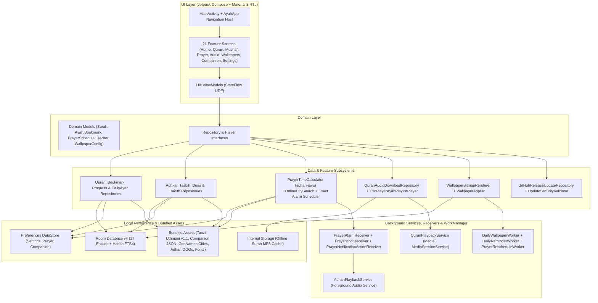

# Ayah Architecture Guide

This document describes the architecture, module boundaries, data layer, background services, and concurrency guarantees of the **Ayah (آية)** Android application (`v1.0.0-beta.12`, `versionCode = 13`, Room Schema `v4`).

---

## 1. Architectural Principles

Ayah follows **Clean Architecture** combined with **MVVM / Unidirectional Data Flow (UDF)** in Jetpack Compose:

1. **Offline-First Truth**: The local Room database (`ayah.db`, schema v4) and Preferences DataStore (`ayah_settings`) are the single sources of truth for all screens.
2. **Strict Layer Separation**:
   - **UI Layer (`ui/`)**: Stateless Jetpack Compose screens, Material 3 components, and `@HiltViewModel` state holders exposing immutable `StateFlow<UiState>`.
   - **Domain Layer (`domain/`)**: Pure Kotlin domain models, calculation contracts, and repository interfaces.
   - **Data & Core Layers (`data/`, `core/`, `feature/`)**: Room entities/DAOs, asset seeders, DataStore preferences, Media3 services, alarm schedulers, and network clients.
3. **Main-Thread Safety**: Disk I/O, Quran/companion database seeding, filesystem audio scans, bitmap wallpaper rendering, and HTTP calls run exclusively on background coroutine dispatchers (`@IoDispatcher` / `Dispatchers.IO`).
4. **Forced Arabic RTL Consistency**: Both `MainActivity` and `AyahApp` enforce `AppLocale.ARABIC` and `LayoutDirection.Rtl` so typography, navigation, and Mushaf pagination remain consistent across all device locales.

---

## 2. High-Level System Diagram



---

## 3. Package Organization

```text
com.ayah.quran
├── AyahApplication.kt             # @HiltAndroidApp entry point; notification channels & startup workers
├── MainActivity.kt                # Single-activity Compose host with Arabic locale wrapper
├── core/
│   ├── database/                  # AyahDatabase (Room v4), AyahMigrations (v1..v4), 9 DAOs, 17 Entities
│   ├── datastore/                 # SettingsDataStore (user preferences, reading, audio, reminders)
│   └── designsystem/              # AyahLightColors, AyahDarkColors, Amiri/IBM Plex Arabic typography, spacing
├── data/
│   ├── audio/                     # QuranAudioDownloadRepository, ExoPlayerAyahPlaylistPlayer, ReciterCatalog
│   ├── companion/                 # CompanionDatabaseSeeder, AdhkarRepository, TasbihRepository, HadithRepository
│   ├── local/                     # QuranDatabaseSeeder, ReadingProgressRepository, WallpaperHistoryRepository
│   ├── model/                     # WallpaperTemplate & data transfer definitions
│   ├── prayer/                    # OfflineCitySearchRepository (GeoNames bundled catalog)
│   ├── quran/                     # QuranTextParser, PageBoundaryLoader, JuzBoundaryLoader
│   ├── repository/                # QuranRepositoryImpl, BookmarkRepositoryImpl, DailyAyahRepositoryImpl
│   ├── service/                   # QuranPlaybackService (Media3), WallpaperGenerator
│   └── update/                    # GitHubReleaseUpdateRepository, UpdateDownloadManager, UpdateSecurityValidator
├── di/
│   ├── AppBindingsModule.kt       # Interface-to-implementation Hilt bindings
│   ├── CompanionModule.kt         # Companion DAOs and seeder providers
│   ├── CoroutineScopesModule.kt   # @ApplicationScope, @IoDispatcher, @MainDispatcher
│   ├── DatabaseModule.kt          # Room database builder with explicit migrations v1..v4
│   └── NetworkModule.kt           # Shared singleton OkHttpClient with 15s connect / 30s read timeouts
├── domain/
│   ├── model/                     # Immutable domain entities (Surah, Ayah, Bookmark, Reciter, etc.)
│   └── repository/                # Repository interfaces
├── feature/
│   ├── prayer/                    # PrayerTimeCalculator, PrayerAlarmScheduler, AdhanPlaybackService, Receivers
│   └── wallpaper/                 # WallpaperBitmapRenderer (1080x2400 Canvas), WallpaperApplier
├── notification/                  # NotificationHelper, DailyReminderScheduler, DailyReminderReceiver
├── ui/
│   ├── AppLocale.kt               # Forced Arabic locale & RTL configuration helper
│   ├── AyahApp.kt                 # Root Scaffold, NavHost, Bottom Navigation, MiniPlayerBar, Splash gate
│   ├── navigation/                # TopLevelDestination (Home, Quran, Prayer, Audio, Wallpapers)
│   ├── components/                # Shared Compose UI components
│   └── screens/                   # 21 feature screens across home, quran, reader, prayer, audio, wallpapers, companion, settings
└── work/                          # DailyWallpaperWorker, DailyReminderWorker, PrayerRescheduleWorker
```

---

## 4. Database Architecture (Room Schema v4)

`AyahDatabase` (`ayah.db`) is configured at **version 4** with `exportSchema = true` and explicit non-destructive migrations (`MIGRATION_1_2`, `MIGRATION_2_3`, `MIGRATION_3_4`):

### 4.1 Core Quran & Wallpaper Entities (6 tables)
1. **`surahs` (`SurahEntity`)**: 114 rows holding Surah number, Arabic/English names, revelation type (`Makki` / `Madani`), Ayah count, and starting Madani Mushaf page.
2. **`ayahs` (`AyahEntity`)**: 6,236 rows holding Surah number, Ayah number, vocalized Uthmani text, normalized search text (diacritics stripped), Madani page (`1..604`), and Juz (`1..30`). Indexed on `(surah_number, ayah_number)`, `surah_number`, `page`, and `juz`.
3. **`bookmarks` (`BookmarkEntity`)**: User-saved Ayah bookmarks with creation timestamps and unique index on `(surah_number, ayah_number)`.
4. **`reading_progress` (`ReadingProgressEntity`)**: Tracks last-read Surah, Ayah, Madani page, reading mode (`MUSHAF` vs `CONTINUOUS`), and daily reading streak history.
5. **`wallpaper_history` (`WallpaperHistoryEntity`)**: Logs generated and applied Quranic wallpapers.
6. **`selection_history` (`SelectionHistoryEntity`)**: Tracks recently featured daily Ayahs to prevent repetition within a rolling window.

### 4.2 Daily Islamic Companion Entities (11 tables)
7. **`dhikr_categories` (`DhikrCategoryEntity`)**: Curated Adhkar categories (Morning, Evening, After Prayer, Sleep, Waking Up, Sunnah Surahs).
8. **`dhikr_items` (`DhikrItemEntity`)**: Individual vocalized Adhkar items with recommended repeat counts, virtue notes, and source references.
9. **`quranic_duas` (`QuranicDuaEntity`)**: Categorized Quranic and Prophetic Duas with direct Surah:Ayah links.
10. **`dhikr_daily_progress` (`DhikrDailyProgressEntity`)**: Per-day completion progress across Adhkar sessions.
11. **`dhikr_favorites` (`DhikrFavoriteEntity`)**: User-favorited Adhkar items.
12. **`tasbih_counters` (`TasbihCounterEntity`)**: Preset and custom Tasbih phrases and target counts.
13. **`tasbih_daily_logs` (`TasbihDailyLogEntity`)**: Daily Tasbih completion totals.
14. **`hadith_collections` (`HadithCollectionEntity`)**: Offline Hadith collections (including An-Nawawi's Forty Hadith and thematic chapters).
15. **`hadith_items` (`HadithEntity`)**: Vocalized Arabic and English Hadith texts, narrators, authenticity grading, and chapter metadata.
16. **`hadith_fts` (`HadithFtsEntity`)**: SQLite **FTS4** full-text search index over `hadith_items` enabling instant offline bilingual search.
17. **`hadith_user_state` (`HadithUserStateEntity`)**: Bookmarked and last-read state for Hadith entries.

---

## 5. Key Subsystems & Concurrency Guarantees

### 5.1 Deterministic Database Seeding
- On cold start, `QuranDatabaseSeeder` and `CompanionDatabaseSeeder` run inside a database transaction on `@IoDispatcher`.
- If `surahs == 114` and `ayahs == 6236`, Quran seeding completes as an instant no-op.
- While first-launch seeding executes, `AyahApp` presents `StartupSplashScreen` and transitions to the main navigation graph only after `QuranRepository.isSeeded()` emits `true`.

### 5.2 Audio Playback & Concurrency-Hardened Offline Downloads
- **Playback (`ExoPlayerAyahPlaylistPlayer` + `QuranPlaybackService`)**:
  - Builds per-Ayah Media3 `MediaItem` playlists for any Surah, automatically preferring locally cached files (`filesDir/quran_audio/{reciterId}/{surah}/{ayah}.mp3`) and falling back to HTTPS streaming (`cdn.islamic.network` / `everyayah.com`).
  - Supports Ayah repeat, Ayah-range repeat, playback speed (`0.75x` to `1.5x`), and sleep timers (`END_OF_AYAH`, `END_OF_SURAH`, `10/20/30` minutes).
  - Playlist preparation uses an atomic generation counter (`prepareGeneration`) so rapid `playSurah()` / `stop()` calls never allow a stale background I/O preparation coroutine to start playback after `stop()`.
- **Offline Downloads (`QuranAudioDownloadRepository`)**:
  - Uses per-Surah `Mutex` locks (`surahLock`), operation-unique temporary `.part` filenames (`{ayah}.{generation}.part`), and atomic generation tracking (`latestGeneration`) to guarantee race-free behavior across concurrent `downloadSurah()`, `cancelDownload()`, `deleteSurah()`, and startup `refreshDownloadedCounts()` scans.
  - `cancelDownload()` immediately cancels both the active OkHttp `Call` and coroutine `Job`, then awaits cleanup under the per-Surah mutex before any subsequent download or deletion for that Surah proceeds.

### 5.3 Prayer Times, Exact Alarms & Adhan Audio Pipeline
- **Calculation (`PrayerTimeCalculator`)**: Wraps `com.batoulapps.adhan` (`adhan-java`) to compute Fajr, Sunrise, Dhuhr, Asr, Maghrib, and Isha locally from coordinates, calculation method, madhab, high-latitude rule, and manual minute adjustments.
- **Scheduling (`PrayerAlarmScheduler`)**: Schedules exact wake alarms via `AlarmManager` with automatic recovery across device boot (`BOOT_COMPLETED`), timezone/time changes (`TIME_SET`, `TIMEZONE_CHANGED`), exact-alarm permission grants (`SCHEDULE_EXACT_ALARM_PERMISSION_STATE_CHANGED`),app package updates (`MY_PACKAGE_REPLACED`), and periodic `PrayerRescheduleWorker` checks.
- **Adhan Audio (`AdhanPlaybackService`)**: Dedicated foreground service with `AudioFocusRequest` management, silent/DND ringer-mode inspection, progressive fade-in option, auto-stop timeout, and single-schedule `PrayerNotificationCoordinator` deduplication.

### 5.4 Quranic Wallpaper Renderer
- `WallpaperBitmapRenderer` renders `1080x2400` `ARGB_8888` bitmaps off-screen using Android `Canvas`, `StaticLayout`, custom Amiri/IBM Plex Arabic typography, and 6 curated visual templates.
- `WallpaperApplier` applies generated bitmaps to `FLAG_SYSTEM` (Home), `FLAG_LOCK` (Lock), or both via Android `WallpaperManager`, and `DailyWallpaperWorker` rotates wallpapers automatically when enabled.

### 5.5 Hardened In-App GitHub Release Updater
- `GitHubReleaseUpdateRepository` queries `https://api.github.com/repos/xAhmedAdel/Ayah-Quran/releases` using a dedicated security-hardened `OkHttpClient` (`followRedirects = false`) that validates redirect hops through `UpdateSecurityValidator.isAllowedDownloadUrl()` (enforcing HTTPS and trusted GitHub release hosts).
- Downloaded APKs are verified against both the release asset's `SHA-256` digest and the currently installed APK signing certificate (`UpdateSecurityValidator.hasMatchingSigningCertificate()`) before invoking Android's `PackageInstaller`.
