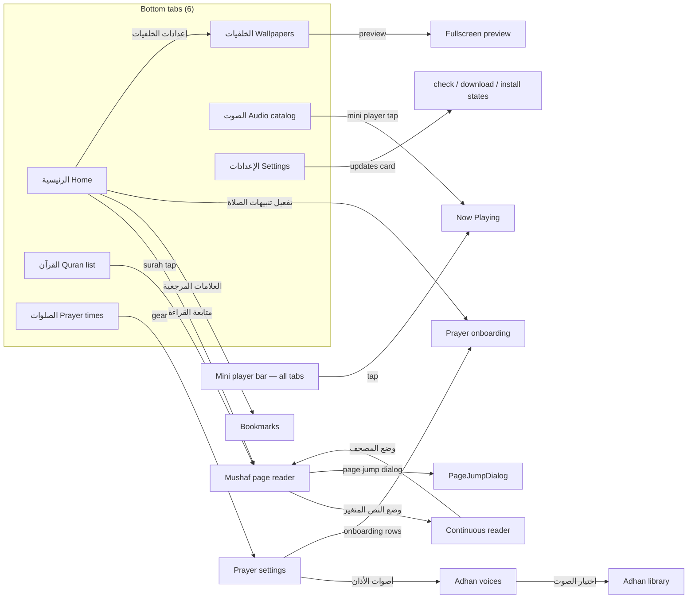

# Navigation Map

Implementation: single-activity Compose navigation — `ui/navigation/AyahApp.kt`.
Routes declared as string constants in the `Routes` object;
top-level destinations in `TopLevelDestination` enum. Bottom bar is
rendered by the app `Scaffold` and hidden on reader screens (immersive).

## Routes (verified from AyahApp.kt)

| Route pattern | Screen |
|---|---|
| `home` | HomeScreen |
| `quran` | QuranScreen |
| `prayer` | PrayerTimesScreen |
| `wallpapers` | WallpapersScreen |
| `audio` | AudioScreen |
| `settings` | SettingsScreen |
| `reader/{surahId}?ayah={ayah}` | ReaderScreen (continuous) |
| `mushaf?surahId={surahId}&page={page}&ayah={ayah}` | MushafPageReaderScreen |
| `bookmarks` | BookmarksScreen |
| `prayer/settings` | PrayerSettingsScreen |
| `prayer/onboarding` | PrayerOnboardingScreen |
| `prayer/adhan-voice` | AdhanVoiceScreen |
| `prayer/adhan-library/{prayer}` | AdhanLibraryScreen |
| `preview/{surahId}/{ayahNumber}` | FullscreenPreviewScreen |
| `audio/now-playing` | NowPlayingScreen |

## Mermaid — major flows

## Behavior notes

- **Back stack**: tab switches use `navigateToTopLevel` (restore state,
  single-top). Reader screens push on the stack; system back pops.
  The reader hides the bottom bar; leaving the reader returns to the tab
  it came from.
- **State restoration**: nav state survives process recreation (Compose
  rememberSaveable + SavedStateHandle args, e.g. mushaf
  `surahId/page/ayah`).
- **Deep links**: none declared.
- **Transitions**: fade + subtle slide (`AyahApp` NavHost transitions,
  respecting a motion-disabled setting).
- **Mini player**: rendered by the outer Scaffold above the NavHost on
  every route EXCEPT `audio`; tapping navigates to `audio/now-playing`.
