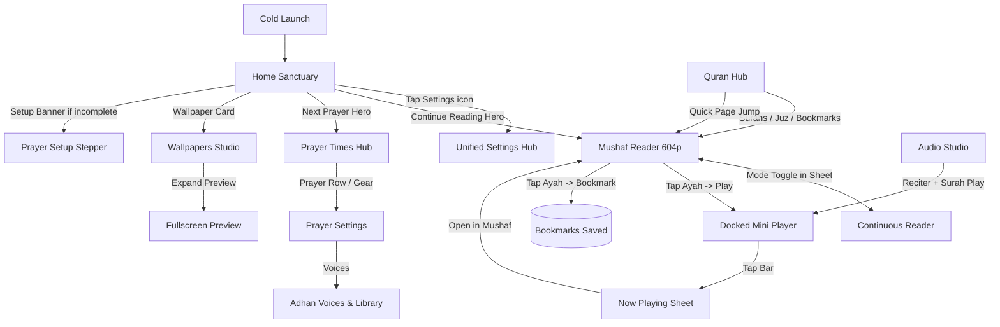

# 02 — User Flows (Current vs Proposed)

Analysis of the 11 core user journeys in Ayah. Every proposed flow eliminates dead-ends, minimizes tap depth, keeps every existing feature intact, and clarifies "Where am I / What can I do / What is the primary action?" at every step.

---

## High-Level Journey Architecture (Proposed)

---

## 1. First Launch

- **Current**: Lands on Home with a large mint-green prayer onboarding card, giant floating wordmark, empty "Continue Reading" box ("Open any surah..."), empty "Current Wallpaper" box, and 6 cramped bottom tabs. Meanwhile Quran DB imports silently in background or blocks Quran tab with spinner.
- **Proposed**:
  1. App opens immediately to **Home Sanctuary** (non-blocking — preserves "skip and continue" rule).
  2. Top compact dismissible **Prayer Setup Banner** invites 1-minute prayer setup (hidden once completed/skipped).
  3. **Start Reading Hero Card** warmly invites opening **Al-Fatihah (Page 1)** with a single prominent CTA (`ابدأ القراءة` / `Start Reading`) plus a secondary `تصفح السور` (`Browse Surahs`) action.
  4. **Next Prayer Card** shows a calm compact location prompt (`تحديد الموقع لمواقيت الصلاة`) with one-tap `موقعي التلقائي` and `اختيار مدينة` right from Home or Prayer tab — no fake times.
  5. **Daily Ayah / Wallpaper Studio Card** previews today's deterministic Daily Ayah rendered beautifully with a single `تخصيص كخلفية` (`Style as Wallpaper`) button.

---

## 2. Continue Quran Reading

- **Current**: User scrolls past the onboarding card and wordmark to find a plain white card (`سورة الفاتحة · الآية 1 من 7`) with a thin bar and small low-emphasis `TextButton("متابعة")`.
- **Proposed**:
  1. **Continue Reading** is the unmistakable visual hero card at the top of Home (only below a slim dismissible setup strip if unconfigured).
  2. Displays Surah name in Amiri calligraphy, current **Page & Juz** alongside Ayah progress (`صفحة ٢٩٣ · الجزء ١٥ · الآية ١ من ١١٠`), a refined progress bar with percentage, and a full-card tap target + high-contrast primary pill (`متابعة القراءة`).
  3. One tap opens `MushafPageReaderScreen` (or `ReaderScreen` if Continuous is preferred) directly at the saved position.

---

## 3. Find a Surah

- **Current**: Tap `القرآن` tab -> type in bare `OutlinedTextField` (no clear button) -> scan flat list where Arabic surah name appears twice on every row -> no Juz browsing or bookmarks access.
- **Proposed**:
  1. Tap `القرآن` tab (Tab 2).
  2. **Quran Hub** shows a clean pill search bar (with instant clear button and Arabic diacritic-tolerant search), a **Quick Page Jump** button (`صفحة...`), and a 3-segment switcher: **السور (Surahs)** · **الأجزاء (Juz 1–30)** · **المحفوظات (Bookmarks)**.
  3. Each Surah row shows an octagonal number badge, calligraphic Surah name (once in Arabic; transliterated + Arabic in English), revelation type (`مكية`/`مدنية`), ayah count (proper Arabic plurals), and starting Mushaf page (`ص ١`).
  4. One tap opens the reader at the Surah's first page.

---

## 4. Navigate to a Page (1..604)

- **Current**: Only possible AFTER opening a Surah into Mushaf Reader -> tapping `"صفحة N من 604"` text button -> typing in `PageJumpDialog` (without numeric keypad) -> tapping Go.
- **Proposed**:
  1. **Path A (From Quran Hub)**: Tap the `انتقال لصفحة` pill next to the search bar -> opens the redesigned **Page & Juz Jump Sheet** with numeric keypad, quick Juz shortcuts, and live Surah preview for the entered page number.
  2. **Path B (Inside Mushaf Reader)**: Tap the bottom page pill (`صفحة ١٤٢ من ٦٠٤`) -> opens the same sheet (preserving validation 1..604 and test semantics) OR drag the refined bottom page scrubber to glide smoothly across pages.

---

## 5. Bookmark an Ayah

- **Current**:
  - In Mushaf mode: Bookmark icon in top bar sits disabled with zero explanation until the user guesses they must tap an ayah first.
  - In Continuous mode: **No bookmark button exists in the UI at all** (even though `ReaderViewModel.toggleBookmark()` exists!).
  - Viewing bookmarks requires backing out to Home and scrolling to the bottom button; bookmarks cannot be deleted from `BookmarksScreen`.
- **Proposed**:
  1. Inside **both** Mushaf and Continuous readers, tapping any Ayah highlights it warmly and smoothly reveals a compact **Ayah Action Pill** anchored above the bottom bar showing `سورة الملك · آية ١٤` with clear icon+label actions: **تشغيل (Play)** · **حفظ (Bookmark/Saved)** · **خلفية (Wallpaper)**.
  2. Tapping **حفظ** toggles the bookmark immediately with haptic tick + subtle confirmation snackbar.
  3. Viewing bookmarks is 1 tap away inside **Quran Hub -> المحفوظات (Bookmarks)** (and also via Home quick shortcut). Each bookmark row shows Uthmani text, localized Surah name + Ayah number, tap-to-open, and a subtle remove button with Undo.

---

## 6. Start & Control Recitation

- **Current**:
  - From Audio tab: Tap play on surah row -> inline `NowPlayingBar` appears, but is **not clickable** to reach `NowPlayingScreen` (user must switch to another tab, find the MiniPlayerBar stuck at the TOP of the screen, and tap it to access sleep timer & speed!).
  - From Reader: In Continuous mode, the "Play from Ayah" button renders at the very bottom of the entire surah (off-screen for long surahs!).
- **Proposed**:
  1. **From Reader**: Tap any Ayah -> tap **تشغيل** on the floating Ayah Action Pill. Playback starts immediately; a slim integrated **Reader Audio Pill** appears cleanly without pushing down the TopAppBar, showing current reciter/ayah + Pause/Play + tap-to-expand Now Playing. Recited ayah highlights and auto-follows pages/scroll smoothly.
  2. **From Audio Studio**: Pick reciter from visual horizontal cards -> tap Play on any Surah -> **Docked Mini Player** rises smoothly immediately above the Bottom Navigation Bar (visible on all 5 tabs including Audio!).
  3. **Full Controls**: Tap the Docked Mini Player anywhere -> opens **Now Playing** full-height modal sheet (MiniPlayerBar hidden while open) with seekable progress bar, RTL-accurate prev/play-pause/next ayah, Stop, Repeat Ayah, Repeat Range (start/end ayah picker wired to existing `setRepeatRange`), Sleep Timer (with live countdown badge), Playback Speed, and an **افتح في المصحف (Open in Reader)** button.

---

## 7. Download Recitation for Offline Use

- **Current**: Scroll an unvirtualized 114-row list with no search and no "Downloaded" filter; tap download icon; see plain text `"جارٍ التحميل 5 / 286"` with no visual bar; delete happens immediately without confirmation.
- **Proposed**:
  1. Open **Audio Studio** -> select desired Reciter card (each card displays count of downloaded surahs for that reciter).
  2. Use search bar or toggle **`المحملة فقط` (Downloaded)** filter chip.
  3. Tap Download on any Surah -> row shows a crisp linear progress bar, `12 / 286` (BiDi-isolated), and a Cancel (`X`) button.
  4. Once complete -> displays emerald offline check pill (`متاح دون اتصال`) and a delete action backed by `ConfirmDialog` so users never accidentally wipe a 286-ayah download.

---

## 8. Configure Prayer Times

- **Current**: Prayer tab shows no-location card -> user picks city -> timetable appears. Adjusting calculation method requires tapping gear -> scrolling past 10 stacked vertical FilterChips -> scrolling past 5x4 Adhan chips -> encountering 3 duplicated permission/battery sections.
- **Proposed**:
  1. Open **Prayers** tab -> if no location, clean centered Location Setup card with `استخدام موقعي` (auto one-shot) and `اختر مدينة` (full-height searchable City Picker sheet with country groupings).
  2. Once configured -> **Emerald Sanctuary Hero Card** shows City, Hijri + Gregorian date, Next Prayer name + live countdown + time + subtle arc progress. Below: clean 5-prayer timetable with active prayer highlight, Sunrise separated cleanly, and per-prayer Adhan mode icon (tappable to change mode directly via quick sheet!).
  3. If notifications or exact alarms are ungranted, a single calm amber **Reliability Strip** sits below the timetable with one-tap `إكمال الإعداد` (opens Setup Stepper).
  4. Tapping the top-bar Settings gear opens a cleanly structured **Prayer Settings** screen where Calculation Method, Asr Method, High-Latitude Rule, Minute Adjustments, and Hijri Offset each occupy 1 crisp summary row opening a focused modal bottom sheet, followed by a single unified **Permissions & Diagnostics** card (eliminating 3x duplication and fixing the `"ممنوح"` bug).

---

## 9. Choose an Adhan Voice

- **Current**: Prayer tab -> Gear -> scroll past 2 long cards -> tap low-contrast `TextButton("أصوات الأذان لكل صلاة")` -> tap `"اختيار الصوت"` on one prayer -> browse noisy cards with redundant delete buttons -> repeat 5 times for all prayers.
- **Proposed**:
  1. From **Prayer Settings** (or directly from the **Adhan Voice** row in the per-prayer quick sheet), open **Adhan Voices**.
  2. Top quick action: **`تطبيق صوت موحّد لجميع الصلوات` (Apply one voice to all prayers)** alongside the 5 per-prayer rows (each showing current voice + inline preview play button).
  3. Tapping any prayer opens **Adhan Library** with pill search (with clear button), single-line category chips (`الكل`, `المدينة المنورة`, `مؤذنون مشهورون`, `مناطق أخرى`, `مدمجة`, `المحملة`), honest Makkah licensing notice when selected, and streamlined cards:
     - Left/Start: Circular Play/Pause preview button with elapsed time when active.
     - Center: Clean voice name (no raw `(CC0)` clutter in title), Muadhin/Mosque, duration + subtle license tag.
     - End: Single clear action (`اختيار` / `محدد` when bundled or downloaded; `تحميل · 3.0 MB` when remote; progress + cancel while downloading; delete action ONLY when downloaded!).

---

## 10. Select & Schedule Wallpapers

- **Current**: Scroll through 6 stacked cards (Preview -> text-only Template chips -> Font/Position/Verse/Mode -> Apply -> Automation -> History). Editing a template or font scale requires scrolling back to the top to see the result.
- **Proposed**:
  1. Open **Wallpapers Studio** (Tab 5).
  2. **Upper 42% (Sticky Live Canvas)**: Rounded phone-frame preview of the live rendered wallpaper (properly clipped!), flanked by subtle floating icon pills: **تبديل الآية (Shuffle)** and **معاينة كاملة (Fullscreen)**.
  3. **Lower 58% (Compact Studio Drawer Tabs)**:
     - **`التصميم` (Design)**: Visual thumbnail swatches for all 5 templates (showing real Emerald/Cream/Midnight/Architecture/Geometric palette previews!) + Font Size slider + Top/Center/Bottom alignment control.
     - **`الآية` (Verse)**: Selection mode 2x2 grid (Random / From Selection / Sequential / Daily) + clean Surah picker sheet & pre-filled Ayah number field.
     - **`التلقائي` (Auto)**: Auto-update switch + clean 6-chip interval flow (30m, 1h, 3h, 6h, 12h, 24h) + honest plain-language scheduling explanation (removing `"WorkManager"` jargon) + last-applied timestamp.
     - **`السجل` (History)**: Thumbnail rows with localized Surah name, timestamp, destination, status, Reapply, and Delete / Clear All with confirmation.
  4. **Pinned Bottom Apply Bar**: Compact Home / Lock / Both segmented pill + prominent primary **`تطبيق الخلفية` (Apply Wallpaper)** button with inline icon+text confirmation toast.

---

## 11. Change Language & Appearance

- **Current**: Tap Bottom Tab 6 (`الإعدادات`) -> see radio cards with mistranslated `"توقّع النظام"` -> no TopAppBar -> scroll down for Updates and Licenses.
- **Proposed**:
  1. Tap the crisp **Settings** icon in the top bar of Home (always visible, 1 tap away).
  2. **Unified Settings Hub** displays logical, calm groups with clear current values:
     - **المظهر (Appearance)**: 3 visual mini-preview cards (`تلقائي (النظام)` · `فاتح` · `داكن`) — instant live switching.
     - **اللغة (Language)**: Clean 2-option segmented card (`العربية` · `English`) — persists & recreates activity cleanly.
     - **التفضيلات (Preferences)**: Quick rows linking directly to **تفضيلات القراءة (Reading Mode & Font Scale)**, **تفضيلات الصوت والتنزيلات (Reciter, Speed, Storage)**, **إعدادات الصلاة والأذان (Prayer & Adhan)**, and **تحديث الخلفيات (Wallpaper Automation)**.
     - **التطبيق والتحديثات (App & Updates)**: Honest GitHub Releases updater status card + version with proper LTR isolation (`1.0.0-beta.6`) + expandable **التراخيص ومصادر البيانات (Licenses & Attribution)** sheet.
