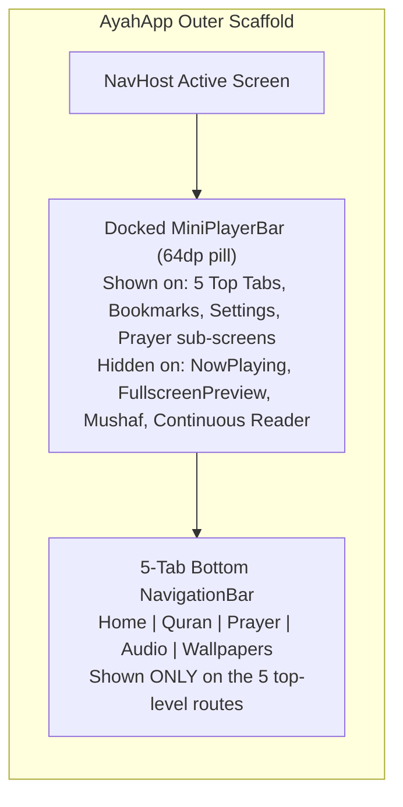

# 07 — Navigation Redesign

Critical evaluation of Ayah's current 6-tab bottom navigation + top-stacked MiniPlayerBar, comparison of structural alternatives, and a clear, evidence-backed recommendation.

---

## 1. Why the Current Navigation Fails

1. **6 Bottom Tabs Violate Ergonomics & Material 3 Standards**:
   - Material 3 `NavigationBar` explicitly specifies **3 to 5 top-level destinations**.
   - With 6 tabs on a `360dp` screen, each tab gets only `60dp` width. Arabic labels (`الإعدادات`, `الخلفيات`, `الرئيسية`) crowd together; English `"Prayer times"` risks truncation/wrapping; at `1.3x`–`1.5x` accessibility font scale, labels collide severely.
2. **Low-Frequency Destination Occupies Prime Thumb Bar**:
   - **Settings (`الإعدادات`)** is opened rarely (theme/language/updates), yet consumes 1/6 of the bottom bar on every single screen — while **Bookmarks** (used frequently by readers) is buried at the bottom of Home!
3. **Fragmented Settings Surfaces**:
   - App settings live in Tab 6 (`settings`), Prayer settings live behind a gear icon on Tab 3 (`prayer/settings`), Wallpaper automation lives buried mid-scroll on Tab 4, and Reader mode/font lives inside the Reader. Users do not know where to look to configure the app.
4. **Broken MiniPlayerBar Hierarchy**:
   - `AyahApp.kt:148-167` places `MiniPlayerBar` at the **top** of the screen above `NavHost` and hides it only on `audio`.
   - Result: (a) Double-header status-bar gap on screens with `TopAppBar`; (b) MiniPlayerBar renders redundantly ON TOP of `NowPlayingScreen`; (c) MiniPlayerBar intrudes into immersive `MushafPageReaderScreen` and `FullscreenPreviewScreen`; (d) On the `Audio` tab, hiding `MiniPlayerBar` without making the inline bar clickable makes `NowPlayingScreen` unreachable!

---

## 2. Navigation Alternatives Compared

### Option 1 — Keep 6 Bottom Tabs (Visual Polish Only)
- **Structure**: `Home · Quran · Prayer · Wallpapers · Audio · Settings`.
- **Pros**: Zero change to `TopLevelDestinationTest.kt` or `AppUiTest.kt` tab assertions.
- **Cons**: Fails Material 3 max-5 guideline; stays cramped on 360dp screens and breaks at large font scaling; wastes prime navigation space on Settings.
- **Verdict**: **Rejected** — preserves a known structural UX flaw.

### Option 2 — 4 Core Tabs + Wallpapers & Settings via Home/Header
- **Structure**: `Home · Quran · Prayer · Audio` (4 tabs); Wallpapers accessible from Home Studio card; Settings via Home header icon.
- **Pros**: Maximum bottom-bar spaciousness (`90dp` per tab); super clean for pure Quran+Prayer users.
- **Cons**: Demotes **Wallpapers** — one of Ayah's signature differentiators ("آية في كل لحظة") with a full engine, scheduler, and history — behind Home scrolling; makes discovering Wallpapers harder for returning users.
- **Verdict**: **Viable Runner-Up**, but under-serves Ayah's Wallpaper pillar.

### Option 3 — **RECOMMENDED: 5 Daily Pillars Bottom Bar + Top-Bar Settings Hub**
- **Structure (RTL right-to-left / LTR left-to-right)**:
  1. **`الرئيسية` / `Home`** (`home`) — Daily sanctuary + top-end **Settings** button (`الإعدادات`)
  2. **`القرآن` / `Quran`** (`quran`) — Unified Quran Hub (`Surahs` · `Juz` · `Bookmarks` · `Quick Page Jump`)
  3. **`الصلوات` / `Prayer`** (`prayer`) — Live next-prayer sanctuary, timetable, and quick Adhan access
  4. **`الصوت` / `Audio`** (`audio`) — Reciters, virtualized Surah audio list, offline downloads
  5. **`الخلفيات` / `Wallpapers`** (`wallpapers`) — Live Quranic Wallpaper Studio & rotation scheduler
- **Settings Entry**:
  - Dedicated `48dp` **Settings** icon button (`Icons.Outlined.Settings`) anchored consistently in the Home header (1 tap from launch), routing to `Routes.SETTINGS` (`settings`, stacked screen with Back arrow).
  - Contextual links inside Unified Settings Hub connect directly to Prayer Settings, Reading prefs, Audio prefs, Wallpapers, Permissions, Updates, and Licenses.
- **Pros**:
  - Strictly complies with Material 3 (`5` destinations = `72dp` per tab on 360dp devices).
  - Short, crisp 1-word labels in BOTH Arabic (`الرئيسية · القرآن · الصلوات · الصوت · الخلفيات`) and English (`Home · Quran · Prayer · Audio · Wallpapers` — note `Prayer` replaces 12-char `Prayer times`).
  - Elevates **Audio** beside **Quran & Prayer** (natural logical grouping: Home -> Read -> Pray -> Listen -> Create).
  - Brings **Bookmarks** directly into the **Quran Hub** (where readers expect it!) while keeping `Routes.BOOKMARKS` working for Home shortcuts.
  - Gives **Settings** a clean, unified home without crowding the thumb bar.
- **Cons**:
  - Requires updating `TopLevelDestinationTest.kt` (6 -> 5 enum entries) and `AppUiTest.kt` (`bottomNavigationBarIconsExposeContentDescriptions` and Settings navigation path) in the Navigation implementation slice.
- **Verdict**: **Strongly Recommended** — best balance of daily ergonomics, brand pillars, Material 3 compliance, and accessibility.

---

## 3. Proposed Complete Route & Shell Architecture

### Mini-Player Visibility Matrix (Fixes Critical Audit Defect #1)

| Route | Bottom Nav Bar | Global Docked MiniPlayerBar | Reader Compact Audio Pill |
|---|---|---|---|
| `home`, `quran`, `prayer`, `audio`, `wallpapers` | Visible | **Visible** (docked above Bottom Bar when active/restorable) | Hidden |
| `bookmarks`, `settings`, `prayer/settings`, `prayer/adhan-voice`, `prayer/adhan-library/{prayer}`, `prayer/onboarding` | Hidden | **Visible** (docked at bottom with nav-bar inset) | Hidden |
| `mushaf?...`, `reader/{surahId}?...` | Hidden | **Hidden** (no double TopAppBar collision!) | **Visible** (slim integrated pill inside reader chrome when active) |
| `audio/now-playing` | Hidden | **Hidden** (never duplicates Now Playing!) | Hidden |
| `preview/{surahId}/{ayahNumber}` | Hidden | **Hidden** (true full-screen immersion) | Hidden |

---

## 4. Back-Stack & State Restoration Guarantees

1. **Tab Switching**: Continues using `navigateToTopLevel()` (`popUpTo(startDestination) { saveState = true }`, `launchSingleTop = true`, `restoreState = true`) so scrolling position on Quran list or Audio list is preserved across tabs.
2. **Reader Mode Switching**: Preserves existing `popUpTo(currentId) { inclusive = true }` behavior so switching Mushaf <-> Continuous never creates a ping-pong back stack; system Back always returns to where the user entered the reader.
3. **Settings Route**: `settings` becomes a standard stacked route (`Routes.SETTINGS = "settings"`) navigated from Home top-bar gear (and optionally reachable from top bar on other tabs if desired, though keeping it cleanly on Home + contextual gear on Prayer keeps headers uncluttered).
4. **Bookmarks Backward Compatibility**: `Routes.BOOKMARKS` remains registered in `NavHost` so Home's Bookmarks shortcut continues working seamlessly alongside the integrated Bookmarks tab inside Quran Hub.
5. **Process Death**: All existing `SavedStateHandle` navigation arguments (`surahId`, `page`, `ayah`, `prayer`) remain byte-identical.
