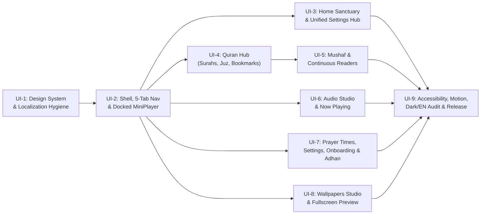

# 09 — Incremental Implementation Roadmap

Phased, independently testable vertical-slice roadmap for implementing the Ayah redesign after Phase UI-0 approval. Every slice leaves the app fully shippable, preserves all protected engines, and passes both unit and instrumented suites before proceeding.

---

## Dependency Graph

---

## Slice-by-Slice Execution Plan

### Slice UI-1 — Design System Foundation & Copy/Localization Hygiene
- **Scope**:
  - Add V2 color tokens (`AyahV2LightColors`, `AyahV2DarkColors`, `AyahExtendedColors`, `LocalAyahColors`), updated typography/spacing/radii, `AyahNumbering.isolateLtr()`, and the 14 shared components in `core/designsystem/component/` (parallel alongside legacy `AyahCard`/`SectionCard` until migration finishes).
  - Optionally add IBM Plex Sans Arabic font resources (`res/font/`) if approved in PO review.
  - Fix critical localization bugs in `res/values/strings.xml` and `res/values-ar/strings.xml` (`توقّع النظام` -> `تلقائي (النظام)`, living reciter attribution, `"صبح فخري"` -> `"صباح فخري"`, remove `"WorkManager"` jargon, add `<plurals>`, add missing `wallpapers_history_ayah_format` in AR, standardize `التشغيل في الخلفية` and `المنبهات الدقيقة`).
- **Files Likely to Change**: `core/designsystem/**`, `res/values/strings.xml`, `res/values-ar/strings.xml`, optional `res/font/`.
- **Protected Behaviors**: `AyahTheme` `ThemeMode` contract, `AppLocale`, `AyahNumbering.toArabicIndic`.
- **Required Tests**: `./gradlew :app:testDebugUnitTest` (all 148 green) + Lint check for `MissingTranslation` / `PluralsCandidate`.
- **Emulator Validation**: Preview theme toggle Light/Dark on existing Settings screen; verify zero M3 neutral-gray surface regressions.
- **Acceptance Criteria**: All new shared components compile cleanly; zero string Lint errors; all 148 JVM + 58 instrumented tests pass.
- **Rollback**: Purely additive layer (existing screens untouched until migrated); revert single commit safely.

---

### Slice UI-2 — Navigation Shell, 5-Tab Bar & Docked Mini-Player
- **Scope**:
  - Update `TopLevelDestination` to 5 daily tabs (`HOME`, `QURAN`, `PRAYER`, `AUDIO`, `WALLPAPERS`) and move `SETTINGS` to stacked `Routes.SETTINGS` (triggered from Home top bar).
  - Relocate `MiniPlayerBar` from top of `Column` to **docked immediately above Bottom Navigation Bar**, applying the visibility matrix (visible on all 5 tabs + sub-screens; hidden on `NowPlaying`, `FullscreenPreview`, `Mushaf`, `Continuous Reader`).
  - Upgrade `MiniPlayerBar` visuals (rounded floating pill, 2dp top ayah-progress hairline, dynamic Play/Pause CD, localized surah/reciter names, distinct restore & Adhan-blocked badges).
  - Introduce stable `testTag`s on navigation items and mini-player.
- **Files Likely to Change**: `navigation/TopLevelDestination.kt`, `navigation/AyahApp.kt`, `ui/audio/MiniPlayerBar.kt`, `ui/audio/MiniPlayerViewModel.kt`, `test/.../TopLevelDestinationTest.kt`, `androidTest/.../AppUiTest.kt`.
- **Protected Behaviors**: `navigateToTopLevel` state preservation, `MiniPlayerViewModel` consumption of `ExoPlayerAyahPlaylistPlayer.state`, restore-never-autoplays contract, `AudioPlaybackEntryPoint.clearRestore()`.
- **Required Tests**: Update `TopLevelDestinationTest` (5 tabs) and `AppUiTest` nav accessibility test; run full JVM + `AppUiTest` + `AudioTabUiTest`.
- **Emulator Validation**: Verify 5 tabs in AR & EN at 1.0x and 1.5x font scale; start audio -> switch across all 5 tabs -> verify zero double-header gap and verify mini-player disappears on `NowPlaying` & Reader.
- **Screenshot Comparison**: Before/after `01_home`, `05_mini_player_home`, `06_now_playing`, `12_wallpapers_tab`.
- **Acceptance Criteria**: Zero top-inset gap when audio plays; 5 tabs fit comfortably without clipping at 1.5x font scale in AR & EN; mini-player hidden on NowPlaying/Reader.
- **Rollback**: Single self-contained shell commit.

---

### Slice UI-3 — Home Sanctuary & Unified Settings Hub
- **Scope**:
  - Redesign `HomeScreen.kt` (+ extend `HomeViewModel` cleanly to expose next prayer summary from existing `PrayerTimeManager` and daily ayah preview from existing `AyahSelector`, plus bookmark count): compact wordmark + Settings icon header, slim dismissible Prayer Setup banner, Emerald Sanctuary Continue Reading Hero card, Next Prayer compact card, Active Wallpaper / Daily Ayah card, quick Bookmarks & Audio row.
  - Redesign `SettingsScreen.kt`: add `TopAppBar` with Back navigation, 3 visual Appearance cards, 2 Language cards, grouped App Preferences navigation rows (Reading, Audio/Storage, Prayer, Wallpapers), clean Updates card, BiDi-isolated version string, and Licenses Modal Bottom Sheet.
- **Files Likely to Change**: `ui/home/HomeScreen.kt`, `ui/home/HomeViewModel.kt`, `ui/settings/SettingsScreen.kt`, `ui/settings/SettingsViewModel.kt`, `androidTest/.../AppUiTest.kt`.
- **Protected Behaviors**: Continue reading real progress (`ayah / ayahCount`), real wallpaper thumbnail & schedule status, honest no-location prayer prompt (never invented times), instant Activity recreate on language change, GitHub Releases updater flow, Tanzil/Amiri/Wikimedia/GeoNames attributions.
- **Required Tests**: `SettingsViewModelTest` (JVM), `AppUiTest` (updated with `testTag`s for Home cards + Settings entry from Home header).
- **Emulator Validation**: Cold launch (empty states) + populated state (reading pos + location + wallpaper) in AR/EN & Light/Dark; switch language AR <-> EN; check updates.
- **Screenshot Comparison**: Before/after `01_home_dashboard`, `13_settings_tab`, `14_settings_updates`, plus new EN & Dark captures.
- **Acceptance Criteria**: Settings reachable in 1 tap from Home; version renders `1.0.0-beta.6` (never reversed) in AR; Continue Reading opens exact saved position.
- **Rollback**: Independent of Quran/Audio/Prayer/Wallpaper internals.

---

### Slice UI-4 — Quran Hub (Surahs, Juz, Bookmarks & Quick Page Jump)
- **Scope**:
  - Redesign `QuranScreen.kt` (+ extend `QuranViewModel` with Juz 1..30 metadata from existing Room data + Bookmarks stream): Header with quick `انتقال لصفحة` pill, `AyahSearchBar` with clear button, 3-segment switcher (`السور` · `الأجزاء` · `المحفوظات`).
  - Fix duplicate Arabic Surah name on `SurahRow`; add `SurahNumberEmblem`, revelation type, proper plural ayah count, and starting page.
  - Redesign `BookmarksScreen.kt` (shared `BookmarksListContent` used both inside Quran Hub tab and `Routes.BOOKMARKS`): fix Latin-only Surah name in Arabic, add one-tap remove bookmark with Undo snackbar.
- **Files Likely to Change**: `ui/quran/QuranScreen.kt`, `ui/quran/QuranViewModel.kt`, `ui/bookmarks/BookmarksScreen.kt`, `ui/bookmarks/BookmarksViewModel.kt`, `androidTest/.../AppUiTest.kt`, `MushafPageReaderUiTest.kt`.
- **Protected Behaviors**: First-launch Quran DB import progress & retry error flow, `SearchSurahsUseCase`, Room bookmark persistence, `Routes.BOOKMARKS` compatibility.
- **Required Tests**: `QuranImportInstrumentedTest`, `BookmarkReadingProgressDaoTest`, `AppUiTest`, `MushafPageReaderUiTest`.
- **Emulator Validation**: Search Arabic & English, clear search, browse Juz 1..30, jump directly to page 300 from Quran Hub, add/view/delete+undo bookmark.
- **Screenshot Comparison**: Capture real `QuranScreen` (replacing misnamed handover screenshot!) in Surahs, Juz, Search, and Bookmarks states.
- **Acceptance Criteria**: Arabic Surah name appears once per row; Bookmarks displays Arabic Surah names in AR; Juz 1..30 opens exact starting page.
- **Rollback**: Isolated to `ui/quran/` and `ui/bookmarks/`.

---

### Slice UI-5 — Mushaf Page Reader & Continuous Reader (Highest Care)
- **Scope**:
  - Restyle `MushafPageReaderScreen.kt` chrome ONLY: minimalist TopAppBar (Back, Surah/Juz/Page title, Settings sheet trigger), shared `MushafSurahBanner` (replacing white shadow card), floating `ReaderAyahActionPill` on ayah tap (Play · Bookmark · Wallpaper -> `preview/{s}/{a}`), compact integrated reader audio pill when reciting, calm bottom page bar with RTL-accurate arrows + redesigned `PageJumpDialog` (numeric keypad, proper Cancel label).
  - Update `MushafText.kt` ONLY for color token reads (`mushafAyahHighlight`, `mushafMarker`) — **zero changes to `buildMushafString` span math or `findAyahAtOffset`**.
  - Redesign `ReaderScreen.kt` (Continuous): unify TopAppBar & `MushafSurahBanner`, fix broken no-op close button (`FontSizeControls` -> `ReaderSettingsSheet`), replace `ScreenRotation` icon with clear Auto-Scroll switch in sheet, anchor `ReaderAyahActionPill` at bottom (fixing off-screen Play button on Al-Baqarah & exposing existing `toggleBookmark`), fix RTL prev/next Surah arrows.
- **Files Likely to Change**: `ui/reader/MushafPageReaderScreen.kt`, `ui/reader/ReaderScreen.kt`, `ui/reader/MushafText.kt` (color tokens only), `core/designsystem/component/{MushafSurahBanner,ReaderAyahActionPill}.kt`.
- **Protected Behaviors**: Byte-identical Tanzil text, 604-page boundaries, pinch-zoom `1f..4f` + double-tap reset, `MushafFollowPolicy` auto page-follow, continuous auto-scroll, reading position save, mode-switch back-stack replacement.
- **Required Tests**: `MushafFollowPolicyTest` (JVM), `GetMushafPageUseCaseTest`, `MushafPageMappingIntegrityTest`, `MushafPageReaderUiTest` (ALL 6 instrumented tests must pass unchanged or with stable `testTag`s!).
- **Emulator Validation**: Full reader pass — swipe page 1 -> 2 -> 604 in AR & EN, pinch-zoom, double-tap reset, jump invalid `"9999"` & valid `"300"`, tap ayah -> Play -> verify highlight + auto page-follow across page turn, tap ayah -> Bookmark, switch Mushaf <-> Continuous, verify font scale `0.5x..2.0x` and close sheet.
- **Screenshot Comparison**: Before/after `02_mushaf_page_mode`, `03_continuous_reader`, `04_reader_play_from_ayah`, `05_auto_page_follow` + Dark mode.
- **Acceptance Criteria**: Zero regressions across all 6 `MushafPageReaderUiTest` cases; zero text clipping at bottom; Play & Bookmark accessible on ayah tap in both modes.
- **Rollback**: Isolated to `ui/reader/`; text pipeline untouched.

---

### Slice UI-6 — Audio Studio & Now Playing
- **Scope**:
  - Convert `AudioScreen.kt` from eager `Column`+`verticalScroll` (114 rows) to virtualized **`LazyColumn`** (resolving top performance defect!).
  - Replace clipped reciter chips with horizontal visual Reciter cards + edge fade + corrected attribution copy; add `AyahSearchBar` + `Downloaded` filter chip; localize reciter & surah names + plural ayah counts; add slim linear download progress bar + `ConfirmDialog` on delete; fix Play/Pause dynamic `contentDescription`.
  - Remove dead legacy Phase-5 playback panel bindings from `AudioScreen` (preserving `AudioPreferencesRepository` and `ExoPlayerAyahPlaylistPlayer` flows intact — verify zero dead flows!).
  - Redesign `NowPlayingScreen.kt`: calligraphic Surah medallion, `Open in Mushaf` shortcut, live `Slider` wired to `positionMs()`/`durationMs()`, prominent transport cluster, expose existing `setRepeatRange` (From/To ayah sheet), responsive `FlowRow`/sheet for Sleep Timer (with active countdown badge) and Playback Speed.
- **Files Likely to Change**: `ui/audio/AudioScreen.kt`, `ui/audio/AudioViewModel.kt`, `ui/audio/NowPlayingScreen.kt`, `ui/audio/MiniPlayerViewModel.kt`, `androidTest/.../AudioTabUiTest.kt`.
- **Protected Behaviors**: `ExoPlayerAyahPlaylistPlayer.state`, `QuranAudioDownloadRepository.states`, `QuranPlaybackService` background/notification/lock-screen playback, Adhan-wins `blockedByAdhan`, restore-never-autoplays.
- **Required Tests**: `QuranAudioCatalogTest`, `QuranPlaybackPolicyTest`, `AudioPreferencesRepositoryTest`, `AudioTabUiTest` (fix pre-existing unformatted assertion & Arabic-only hardcoding so test passes in AR and EN!).
- **Emulator Validation**: Stream surah, download surah & watch live progress bar, cancel download, delete with confirmation, open Now Playing directly from Audio tab, test seek bar + repeat ayah + repeat range + sleep timer + speed + Adhan interruption.
- **Screenshot Comparison**: Before/after `04_audio_tab_catalog`, `06_now_playing`, `08_audio_nowplaying_bar`.
- **Acceptance Criteria**: Smooth 60fps scroll over 114 surahs; Now Playing reachable from Audio tab; seek bar & repeat range functional; English locale displays localized names & counts.
- **Rollback**: Isolated to `ui/audio/`.

---

### Slice UI-7 — Prayer Times, Prayer Settings, Onboarding & Adhan Library
- **Scope**:
  - Redesign `PrayerTimesScreen.kt`: Deep Emerald Sanctuary Hero card with live `tnum` countdown, progress bar, localized Hijri (`هـ`/`AH`), structured 5-prayer timetable with active row highlight + per-prayer Adhan mode icon + Quick Adhan Sheet, separated Sunrise row, conditional Reliability banner, and searchable City Picker Bottom Sheet.
  - Redesign `PrayerSettingsScreen.kt` + `PermissionsDashboardSection.kt`: 4 clean groups with Modal Bottom Sheets for Calculation Method (10), High-Lat (3), Minute Adjustments, and Per-Prayer Modes; expose Hijri adjustment (`-2..+2`); **delete 2 duplicated permission cards & stale empty-library copy**; **fix denied notification grant button label (`"ممنوح"` -> `"تفعيل الإشعارات"`)**; collapse Diagnostics accordion cleanly.
  - Redesign `PrayerOnboardingScreen.kt`: guided 5-step progress stepper replacing radio-button circles with numbered/verified step badges; keep real-time `ON_RESUME` verification & vendor guidance dialog.
  - Redesign `AdhanVoiceScreen.kt` (grouped 5-prayer card + "Apply to all prayers" shortcut + inline preview) & `AdhanLibraryScreen.kt` (streamlined single-action cards, single-line category chips, **remove Delete icon from un-downloaded items**).
- **Files Likely to Change**: `ui/prayer/*.kt`, `androidTest/.../PrayerTimesUiTest.kt`.
- **Protected Behaviors**: Offline `adhan-java` calculation, exact alarms & boot re-arm, `PrayerNotificationsChannels`, `AdhanPlaybackService` (`USAGE_ALARM`), Adhan-wins priority, honest unverified permission reporting, diagnostic alarm/test buttons, `PrayerPermissionsInstrumentedTest` compatibility.
- **Required Tests**: `PrayerTimesCalculatorReferenceTest`, `NextPrayerCalculatorTest`, `PrayerStatusReducerTest`, `VendorDetectionTest`, `AdhanVoiceResolverTest`, `BundledAdhanCatalogTest`, `AdhanAudioInstrumentedTest`, `PrayerPermissionsInstrumentedTest`, `PrayerTimesUiTest`.
- **Emulator Validation**: Test no-location -> select Cairo -> verify timetable & live countdown -> tap prayer row to toggle Adhan -> open Prayer Settings & test every sheet -> walk 5-step onboarding -> browse/preview/download/select/delete in Adhan Library -> fire test notification & test adhan.
- **Screenshot Comparison**: Before/after `07_prayer_times`, `08/09_prayer_settings`, `10_adhan_voices`, `11/12_adhan_library`, `13_onboarding_steps`.
- **Acceptance Criteria**: Zero duplicated permission sections; zero `"ممنوح"` bug; zero delete icon on un-downloaded Adhan; all diagnostics & real permission checks verified.
- **Rollback**: Isolated to `ui/prayer/`.

---

### Slice UI-8 — Wallpapers Studio & Fullscreen Preview
- **Scope**:
  - Redesign `WallpapersScreen.kt` into sticky Live Phone-Frame Preview (with `clip(RoundedCornerShape(20.dp))`, shuffle & fullscreen pills, zero duplicate reference text) + 4 clean lower studio tabs (`التصميم` with **5 visual template swatches**, `الآية` with pre-filled ayah field & Surah sheet, `التلقائي` with plain-language copy & 6-chip `FlowRow`, `السجل` with clipped thumbnails) + pinned bottom Apply bar (Home/Lock/Both + primary Apply CTA).
  - Redesign `FullscreenPreviewScreen.kt`: dark-scrim close pill (legible over light & dark templates), floating destination selector, accurate destination confirmation copy.
- **Files Likely to Change**: `ui/wallpapers/WallpapersScreen.kt`, `ui/wallpapers/FullscreenPreviewScreen.kt`, `ui/wallpapers/FullscreenPreviewViewModel.kt` (destination param if needed), `androidTest/.../AppUiTest.kt`.
- **Protected Behaviors**: `WallpaperRenderer` text fitting & RTL layout, 5 launch template IDs (`WallpaperTemplateContractTest`), `WallpaperManager` combined flags & bitmap lifecycle, WorkManager rotation scheduling.
- **Required Tests**: `WallpaperTemplateContractTest`, `AyahSelectorTest`, `WallpaperRendererInstrumentedTest`, `WallpaperApplyInstrumentedTest`, `WallpaperSchedulingInstrumentedTest`, `AppUiTest`.
- **Emulator Validation**: Switch all 5 templates watching live sticky preview update; drag font scale & position; pick Surah/Ayah; open Fullscreen preview; apply to Home / Lock / Both; enable/disable rotation; reapply/delete/clear history.
- **Screenshot Comparison**: Before/after `12_wallpapers_tab` + new Fullscreen Preview & History captures.
- **Acceptance Criteria**: Live preview visible during all design edits; rounded bitmap clipping clean; close icon always readable on all 5 templates.
- **Rollback**: Isolated to `ui/wallpapers/`.

---

### Slice UI-9 — Final Hardening, Accessibility, Motion & Cleanup
- **Scope**:
  - Remove deprecated legacy components (`AyahCard` old wrapper, unused `PlaybackControls`/`SeekBarRow` files, unused legacy `AudioViewModel` Phase-5 panel state if no tests depend on it — verify first!).
  - Full accessibility audit: TalkBack pass in Arabic RTL & English LTR, `1.5x` and `2.0x` font scaling pass, `ANIMATOR_DURATION_SCALE = 0` reduced-motion pass, Dark & Light contrast verification on every screen.
  - Full regression run: `./gradlew :app:testDebugUnitTest`, `./gradlew :app:connectedDebugAndroidTest`, `./gradlew :app:assembleRelease`.
  - Capture complete before/after screenshot archive for both Arabic RTL (Light & Dark) and English LTR.
- **Acceptance Criteria**: 100% JVM & instrumented suites green; zero R8/minify release warnings; zero dead flows; zero clipped layouts at 1.5x font scale.
